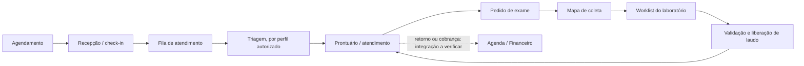

# Auditoria inicial de fluxos operacionais — EloLab

Data: 2026-10-29
Escopo desta rodada: cadeia clínica agenda → recepção/fila → prontuário → exames → laboratório/laudos. Auditoria baseada em código e documentação existente; não foi feita gravação de dados nem inspeção visual autenticada.

## Diagnóstico

- O roteador em `src/App.tsx` tem mais de 120 declarações de rota. Há páginas canônicas, aliases/redirecionamentos e áreas públicas, então a contagem de rotas não corresponde à de fluxos.
- O menu `src/config/sidebarMenu.ts` organiza entradas por área e perfil, enquanto as regras de rota em `src/App.tsx` restringem acesso por papel e, em alguns módulos, por plano. Isso dá uma base de autorização, mas não demonstra por si só a continuidade da jornada entre registros.
- Há um fluxo explícito de triagem como aba contextual da fila (`/fila?tab=triagem`) para perfis autorizados. Agenda e recepção possuem áreas próprias; a continuidade entre registros precisa ser verificada em cenários ponta a ponta com dados sintéticos.
- O Laboratório já possui estados operacionais e atualização com status esperado. `src/pages/Laboratorio.tsx` bloqueia gestão por papel e orienta liberação de resultados pelo módulo Laudos. `src/pages/MapaColeta.tsx` registra eventos e aplica transições condicionadas ao status atual.
- A documentação do módulo Laboratório descreve rastreabilidade, rejeição/recoleta, validação/liberação e retificação autorizada. Dependências de banco/RLS e revisão do responsável técnico continuam pendentes conforme `docs/LABORATORIO_PROGRESS.md`.
- Não há evidência suficiente nesta rodada para afirmar se agendamento confirmado prepara recepção automaticamente, se check-in encaminha para fila sem repetição, ou se encerramento clínico origina retorno/cobrança. Essas ligações exigem rastreamento dos handlers e validação no ambiente isolado.

## Jornada clínica — mapa de investigação

As setas representam a jornada de produto a verificar, não automações confirmadas. Não presumir mudança de estado entre módulos sem evidência no código/backend.

## Estados confirmados no código revisado

| Área | Evidência | Observação |
|---|---|---|
| Fila/triagem | `src/pages/AtendimentoFila.tsx` | Triagem aparece somente para `admin`, `medico` e `enfermagem`; recepção acessa a fila sem essa aba. |
| Worklist do laboratório | `src/pages/Laboratorio.tsx` | Contabiliza pendente, coletado, em análise, validado, liberado e cancelado; gestão depende de perfil. A página informa que liberação de resultado acontece em Laudos. |
| Coleta/rastreabilidade | `src/pages/MapaColeta.tsx` | Transição grava apenas se o status atual ainda pertence ao conjunto esperado; falha por estado alterado pede atualizar o mapa. Há histórico de eventos e fluxo explícito de rejeição/recoleta/cancelamento. |
| Laudos | `src/pages/LaudosLab.tsx` | O código consulta estado de liberação/validação e mantém fluxo de retificação; revisar matriz completa de papéis e transições antes de redesenhar. |

## Priorização

### P1 — Jornada de chegada e atendimento

Seguir um agendamento real sintético até check-in, fila, triagem e prontuário. Registrar para cada transição: gatilho, registro alterado, perfil, confirmação, falha, retorno ao contexto e duplicidade. Esta é a primeira frente de redesign porque atravessa as tarefas diárias de recepção, enfermagem e médico.

### P1 — Pedido de exame até laudo disponível

Verificar origem do pedido, autorização/plano, criação da coleta, operação concorrente, evento de rastreabilidade, regras de resultado crítico, validação, liberação e disponibilidade no prontuário. Não remover barreiras clínicas nem simular a integração de banco que está pendente.

### P2 — Encerramento clínico e próxima ação

Rastrear o que atendimento encerrado efetivamente atualiza e separar comportamento existente de oportunidade futura para retorno/cobrança. O financeiro de pacientes e os fluxos de Mercado Pago permanecem fora de alterações desta frente.

### P2 — Navegação e retorno de contexto

Confirmar se abrir paciente, exames e laudos preserva o registro de origem e se voltar retorna à fila/filtro/posição anterior. Manter aliases para compatibilidade, direcionando links novos à rota canônica.

## Próxima rodada

1. Traçar handlers e queries da agenda, recepção e fila, com foco em check-in e prevenção de duplicidade.
2. Cruzar permissões frontend com regras de autorização/RLS pertinentes sem usar conexão de produção.
3. Percorrer a jornada em base sintética isolada e registrar capturas desktop/tablet/mobile.
4. Só então propor a arquitetura do workspace de recepção e implementar uma fatia vertical reversível.

## Progresso da reconstrução — 2026-10-29

### Mudanças desta rodada

- Tokens globais alinhados à paleta azul primário/navy/ciano e aos neutros claros. Os aliases `gradient-*` agora resolvem para cores sólidas por compatibilidade; sombras de destaque ficaram neutras.
- A navegação removeu cores decorativas independentes por grupo, usa tokens semânticos da sidebar navy/ciano e não duplica links filhos no modo recolhido.
- O Prontuário removeu quatro indicadores redundantes sem retirar dados ou operações.
- A worklist do Laboratório encaminha um item validado diretamente para o laudo da coleta usando `?coleta=<id>`, estado já suportado por Laudos; a etapa Em análise usa o token semântico `info`.
- A barra de agenda do shell usa fundo navy, estado atual em azul primário, avatares neutros sem foto e sombra discreta.
- O hero público removeu o fundo animado Prism e passou a usar CTAs sólidos da paleta.
- A demonstração consolidou os indicadores fictícios numa faixa responsiva; superfícies e botão agora usam tokens com contraste legível.

### Evidências e validação

- E2E sintético em `tests/ux-visual-synthetic.spec.ts`: passaram Agenda (1), Fila/Recepção, Laboratório, busca de pacientes e Prontuário (5), landing pública em desktop (1) e demonstração em 1280 px/375 px (1). A demonstração não tem overflow e o CTA mede contraste ≥ 4,5:1.
- A verificação de pares semânticos WCAG AA passou após ajustar `muted` (um par estava em 4,45:1; agora todos os pares da amostra passam).
- `npx tsc --noEmit -p tsconfig.app.json`: sem erros. ESLint focal: zero erros; 110 avisos `no-explicit-any` nos arquivos Prontuário/Laboratório. `git diff --check`: limpo.
- `npm run check:a11y` passou para nomes acessíveis e interativos aninhados; o script não mede contraste visual.
- Capturas Playwright da demonstração foram inspecionadas em desktop e celular. O hero público também foi inspecionado no navegador antes e depois da remoção do fundo animado.
- A página pública foi executada com URL Supabase fictícia e chave sintética; nenhuma sessão real ou dado de paciente foi usado.

### Pendente

- Inspeção renderizada do shell autenticado e do Laboratório. O servidor local sem configuração Supabase fica no loader; o servidor isolado renderiza rotas públicas, enquanto `/dashboard` e `/laboratorio` exigem sessão. Os E2E sintéticos verificam conteúdo e interações, mas não substituem a inspeção manual dessas telas.
- A paleta ainda não foi migrada de todos os valores hardcoded. Esta rodada é o início da consolidação, não prova de uniformidade do app inteiro.
- Falta concluir o rastreamento e a validação integral da cadeia check-in → fila → triagem → prontuário → pedidos → laudo e revisar os estados excepcionais em ambiente sintético.

## Limites

- Nenhuma conexão de produção, migration ou deploy foi usado.
- Foram executados testes sintéticos selecionados, sem acesso a produção. Não é uma validação ponta a ponta de todas as jornadas.
- A inspeção visual autenticada ficou pendente; a inspeção da rodada cobriu a demonstração pública e o hero público.
- A direção cromática vigente é a paleta azul/ciano/navey especificada pelo responsável; a especificação antiga “Intellecta” não prevalece sobre ela.

## Fatia incremental — recepção e check-in (2026-10-29)

### Diagnóstico e fluxo observado

- A rota `/recepcao` mantém os perfis já autorizados (`admin`, `recepcao` e `financeiro`); nenhuma permissão foi alterada.
- A fila do dia reúne dados de agendamento, paciente, profissional, sala, fila e cobrança para derivar o estágio operacional. No estágio inicial, o operador pode iniciar check-in ou triagem.
- O check-in existente valida paciente ativo, vínculo com o agendamento, data do atendimento, estados terminais, atendimento já iniciado e vínculo com a clínica. Em seguida chama `checkinComCobranca`, invalida as consultas de agenda/fila/lancamentos e apresenta o resultado. A regra, integração e transição existente foram preservadas.
- Impacto identificado: durante o registro, todas as ações já eram bloqueadas por `isProcessing`, mas a linha não indicava qual check-in estava em andamento. Isso reduzia a clareza em uma fila com vários pacientes.

### Alteração e evidência

- Em `src/pages/Recepcao.tsx`, o item em processamento agora recebe `aria-busy`, mostra indicador de carregamento e o rótulo “Registrando…”. O estado da linha é definido ao iniciar e limpo no `finally`; o bloqueio global e todas as regras anteriores continuam iguais.
- Nenhum contrato de API, papel, permissão, cobrança, dado de produção ou estado persistido foi modificado.
- Testes focados existentes: `npx vitest run src/lib/checkinValidacao.test.ts src/lib/__tests__/checkinWithBilling.test.ts` — 15 testes passaram.
- ESLint focal em `src/pages/Recepcao.tsx` — zero erros e 49 avisos preexistentes de `no-explicit-any`.
- A tentativa de executar o teste visual direcionado (`npx playwright test tests/ux-visual-synthetic.spec.ts --grep "reception first fold keeps a filled synthetic queue visible" --reporter=line`) parou na configuração: `127.0.0.1:4173` já estava ocupado pelo processo PID 17044. O processo não foi interrompido. A tela autenticada e o novo estado de carregamento não foram inspecionados visualmente; validação visual permanece pendente.

## Iteração 2026-10-29 — fila, tokens sólidos e entrada por perfil

### Diagnóstico e decisões

- A captura autenticada sintética da Fila revelou texto branco sobre fundo quase branco na etapa “Em atendimento” e na aba selecionada. A causa foi o alias `bg-gradient-*`: o token já era uma cor sólida, mas o Tailwind ainda o gerava como `background-image`, que rejeitou esse valor. O mesmo risco se estendia a botões, abas e estados em outras rotas.
- Os aliases antigos agora geram cores sólidas `primary`, `brand-dark` e `sidebar`; referências diretas a imagens de gradiente foram removidas dos botões, badges, abas, dashboard, login, empty state e prontuário. As classes preservadas mantêm compatibilidade sem adicionar efeitos visuais de gradiente.
- A etapa “Em atendimento” usa fundo `primary`, texto `primary-foreground` e o token `info` para triagem. O teste verifica contraste do título da etapa em 4,5:1 ou mais.
- Uma conta exclusiva da plataforma que entrava em `/dashboard` via login caía no dashboard clínico sem vínculo de clínica. Agora segue para `/painel-admin`. Atalhos de mapa/laboratório da enfermagem respeitam o recurso `exames`; as proteções das rotas continuam responsáveis pelo acesso final.
- O check-in na Recepção identifica qual paciente está sendo processado com indicador, texto “Registrando…” e `aria-busy`; validações, RPC, cobrança, papéis e persistência continuam inalterados.

### Evidências e validação desta iteração

- Playwright sintético da fila passou em 1440, 1280 e 375 px; confirmou agenda operacional, prioridade, triagem, chamada, remoção cancelável, teclado Escape, movimento reduzido e ausência de overflow horizontal. As capturas de três tamanhos foram geradas; a captura de 375 px e a etapa corrigida em desktop foram inspecionadas visualmente.
- Playwright da entrada da plataforma passou com perfil sintético sem clínica. A tela `/painel-admin` foi inspecionada visualmente; mostrou orientação de vínculo pendente do app clínico e estados de disponibilidade retornados pelo backend sintético.
- Testes unitários de atalhos por perfil: Vitest 5/5 passou. Playwright de dashboard, fila e acesso de recepção passou 4/4. TypeScript passou sem erros; ESLint focal: zero erros, avisos existentes de `no-explicit-any`/`react-refresh`; `git diff --check` limpo antes da atualização final do relatório.
- Esta captura autenticada sintética atualiza a nota anterior: shell clínico e painel da plataforma foram vistos; nenhum token ou backend de produção foi usado.

### Auditoria de laboratório — somente leitura

- Pedido cria de 1 a 40 exames vinculados e valida clínica, paciente, profissional, plano e catálogo na RPC. Mapa de coleta usa paginação, realtime, comparação de status esperado e eventos auditados; coleta em lote relata falhas parciais. Laudos validam resultados antes de liberar, com RPCs atômicas, controle de estado crítico e retificação versionada.
- Risco pendente: criação de coleta usa pré-consulta para duplicidade, mas não foi localizada garantia única concorrente; recoletas intencionais precisam continuar possíveis. Não houve alteração de schema nem contrato.
- Risco pendente: rotas limitam perfis com mais precisão que algumas RPCs, que aceitam `can_access_clinical`; revisar a intenção de autorização antes de mudar. Notificação pós-liberação ocorre depois do commit e não desfaz a liberação se falhar.
- Visual do Laboratório/Laudos e disponibilidade real da integração de notificação continuam pendentes. A auditoria usou código e migrations locais, sem afirmar versão implantada.

### Próxima prioridade

1. Validar visualmente a Recepção preenchida e o estado de check-in em andamento; percorrer check-in → fila → triagem com fixtures sintéticas.
2. Fechar a matriz por papel/plano na jornada pedido → coleta → laudo; definir cardinalidade de pedido para coleta antes de qualquer prevenção concorrente.
3. Auditar financeiro geral e painéis restantes sem tocar na cobrança de planos nem nas integrações de Mercado Pago; revisar cores hardcoded por módulo em vez de aplicar substituição global.
### Validação visual de recepção — 2026-10-29

- A amostra sintética revelou sete indicadores comprimidos numa única linha a 1280 px, com títulos em caixa alta e detalhes truncados. `PainelDoDia` mantém os sete filtros e valores, mas usa duas colunas em celular, quatro em desktop intermediário e sete apenas a partir de 1536 px; títulos ficaram em texto normal e detalhes podem quebrar linha antes da grade larga.
- Inspecionei a página renderizada em 1280 px, 1440 px e 390 px. A grade ficou legível, o resumo ocupa duas linhas no desktop e quatro no celular, e não há overflow horizontal no celular.
- Playwright manteve o check-in real sintético pendente via RPC interceptada, confirmou `aria-busy`, “Registrando…” e botão desabilitado, depois abortou a chamada mockada e confirmou a mensagem de erro e o retorno do botão ao estado normal. Nenhuma escrita chegou a backend real.
- Vitest da faixa do dia e dashboard: 9/9; TypeScript sem erros; ESLint sem erros, com avisos preexistentes de `no-explicit-any`; `git diff --check` foi executado após esta fatia.
## Auditoria financeira geral — somente leitura (2026-10-29)

- Perfis das rotas `/financeiro`, `/contas` e `/fluxo-caixa` conferem com admin/financeiro; `/recepcao` aceita admin/recepção/financeiro e mantém as abas internas limitadas por perfil. Caixa Diário conserva suas RPCs, idempotência e log de eventos.
- Financeiro, Contas e Fluxo de Caixa têm estados distintos de carregamento, erro, vazio e recuperação; as fontes de movimentação usam escopo de clínica e avisam quando alcançam o limite de dados.
- Atrito identificado: `/contas` preserva a aba no parâmetro `tab`, mas Financeiro mantém mês/aba em estado local e Fluxo de Caixa mantém mês local. A investigação não pode ser compartilhada nem restaurada por URL nesses dois destinos. Caixa Diário também mantém subaba local, mas ficará fora da primeira fatia.
- Prioridade sugerida: preservar mês e aba nas URLs de Financeiro e Fluxo de Caixa e manter o contexto ao navegar entre rotas existentes; nenhuma regra de baixa, saldo, RPC ou permissão precisa mudar.
- Escopo excluído nesta auditoria: checkout e cobrança do plano EloLab, Mercado Pago, tabela `pagamentos_mercadopago`, módulo de pacientes e persistência financeira.
### Consolidation of visual rules — 2026-10-29

- `DESIGN.md` now matches the specified EloLab blue/cyan/navy palette, Inter typography, neutral backgrounds and solid primary button states. Focus ring and first chart token now match the primary token.
- Removed the decorative cyan blur from role dashboard hero surfaces and the unused shimmer animation from the premium button. The doctor dashboard was re-captured and inspected with a solid navy context panel.
- Hardcoded legacy blue/purple values remain across many modules. They were not globally replaced; each module still needs a targeted contrast and semantic-color review.

### Navegação financeira por URL — 2026-10-29

#### Diagnóstico e decisão

- `/financeiro` mantinha mês e aba em estado local; `/fluxo-caixa` mantinha apenas o mês local. Links não podiam reproduzir a consulta, e voltar/avançar no navegador não restaurava o contexto.
- A URL agora é a fonte desse estado: `/financeiro?mes=AAAA-MM&tab=resumo|dre|categorias` e `/fluxo-caixa?mes=AAAA-MM`. Navegar entre os dois workspaces leva o mês selecionado. Trocar mês/aba cria entradas de histórico; parâmetros inválidos são normalizados com `replace`, sem apagar parâmetros não relacionados. “Hoje” usa o mês de São Paulo.
- O ajuste altera somente apresentação e navegação. Queries, cálculos, APIs, permissões, pagamentos e operações financeiras foram mantidos.

#### Validação visual e funcional

- Inspecionei capturas do Painel Financeiro e do Fluxo de Caixa em 1280×800 e 390×844. A navegação continua usando a hierarquia existente; no mobile, filtros, indicadores e ação “Visão financeira” permanecem acessíveis sem overflow horizontal. O Fluxo exibe uma explicação específica e ações contextuais quando o mês está vazio.
- Playwright sintético: 5/5 passaram. Cobriu deep link de mês/aba, mês anterior, histórico back/forward, normalização de URL inválida, transição entre workspaces, dados sintéticos positivos, vazio, carregamento, falha com recuperação e bloqueio do perfil médico. Nenhuma escrita foi enviada a um backend real.
- Vitest do estado de rota: 10/10. TypeScript: sem erros. `git diff --check`: limpo. ESLint focal: zero erros e 10 avisos preexistentes nos dois módulos (dependências de `useMemo` e `any`); os novos utilitário/testes não adicionaram avisos.

#### Limitações desta fatia

- As capturas mostram a versão atual com dados sintéticos. Não havia captura visual anterior equivalente para comparação pixel a pixel; a mudança de UX foi validada por URL/histórico, e o layout atual foi inspecionado.
- Não foram verificados dados reais nem permissões/RLS no backend. O bloqueio por perfil foi coberto pelo guard de rota sintético, sem alterar as regras.
- O Painel Financeiro ainda apresenta vários indicadores em cartões. A revisão de hierarquia e densidade desse módulo é uma fatia de redesign posterior; esta entrega se limitou a preservar o workspace e corrigir continuidade de navegação.

### Laboratório — navegação interna em celular — 2026-10-29

#### Diagnóstico e decisão

- A worklist existente cobre estados, filtros, setor, urgência e etapas do laboratório. A inspeção em 390 px mostrou que as cinco abas internas eram uma faixa horizontal; parte do rótulo “Gestão do laboratório” ficava fora da área visível, sem sinal claro de que o usuário precisava arrastar.
- As abas agora quebram em linhas no mobile, mantendo a lista completa visível e os mesmos rótulos, estados, papéis e componentes Radix. Desktop continua em uma linha porque há largura suficiente. Nenhum fluxo de coleta, query, mutação ou permissão mudou.

#### Validação visual e funcional

- Capturei e inspecionei a worklist com amostras e o Pipeline em 1280×800 e 390×844. No mobile, as cinco seções agora aparecem em duas linhas, sem corte; o topo com resumo/ação de coleta permanece legível e a grade do Pipeline usa duas colunas. Desktop preservou a linha única.
- Playwright sintético passou em 1440, 1280 e 390 px. Cobriu busca/itens populados, resumo de urgência, alternância Worklist/Pipeline, filtro por pendente, navegação por teclado entre indicadores, contagem e ausência de overflow horizontal geral e na lista de abas. As requisições permaneceram mockadas.
- Antes da correção, a nova verificação de largura reproduziu a falha no viewport de 390 px (`scrollWidth > clientWidth` na lista de abas); depois da mudança, passou.

#### Limitações desta fatia

- A visualização usou somente dados sintéticos; não houve acesso a runtime ou registros reais. A captura cobre a worklist e o pipeline, não todas as telas do LIS.
- Mapa de Coleta, Laudos, permissões/RLS reais, erro de consulta e falhas de integração continuam pendentes de inspeção visual e validação no ambiente isolado. As cores de estado hardcoded desta tela também continuam aguardando uma revisão semântica específica; não foram substituídas globalmente.

### Mapa de Coleta — leitura e densidade responsiva — 2026-10-29

#### Diagnóstico e decisão

- A worklist por sala/setor preserva código de amostra, paciente, tubo, status e ações. No celular, a tabela existente se transforma em linhas legíveis com rolagem vertical da página; ações de coleta, cancelamento e detalhes permanecem disponíveis.
- A captura a 1280 px mostrou os seis indicadores em uma linha com títulos e descrições truncados (por exemplo, “Pendentes” e “SLA crítico”). O grid agora usa duas colunas em telas estreitas, três até desktop intermediário e seis apenas em telas a partir de 1536 px. A seleção continua acionando o mesmo filtro rápido.
- Nenhuma transição clínica, escrita, filtro, dado ou autorização foi alterada.

#### Validação visual e funcional

- Inspecionei capturas preenchidas em 1280×800 e 390×844. Após o ajuste, os seis indicadores em 1280 px são lidos em duas linhas; a próxima coleta, urgência e ações permanecem claras. No celular, indicadores ficam em duas colunas e a linha da amostra expõe código, paciente, status e ações sem overflow horizontal da página.
- Playwright sintético: passou em 1440, 1280 e 390 px. Validou contagem de colunas (6/3/2), fila e identidade da amostra, ações visíveis, largura da página e abertura/fechamento do detalhe por Escape. Requisições permaneceram mockadas.
- A nova expectativa da grade falhou antes da mudança em 1280 px (seis colunas em vez de três) e passou depois. TypeScript: sem erros; ESLint focal: zero erros e avisos existentes de `any`/dependências de hooks; verificação de acessibilidade passou; `git diff --check` limpo.

#### Limitações desta fatia

- A inspeção usou amostra sintética. Não executei a mutação real de coleta, seleção em lote, rejeição/recoleta ou histórico de eventos. Testes de erro de consulta, carregamento prolongado, perfis/RLS reais e interrupções de realtime continuam pendentes.

### Laudos — detalhe crítico responsivo e barreira de liberação — 2026-10-29

#### Diagnóstico e decisão

- A captura mobile de um resultado crítico mostrou o parâmetro e três estados disputando uma única linha. Os rótulos longos eram comprimidos em pílulas estreitas, dificultando identificar “Crítico”, “Aguardando ciência e conduta” e “Pendente”.
- No modal, o resumo do parâmetro agora vem primeiro e os estados ficam abaixo em uma linha flexível que pode quebrar. Desktop mantém o resumo e os estados lado a lado quando houver espaço. A interface não alterou permissões, fluxo de validação, RPCs ou notificações.
- A barreira existente foi preservada e exercitada: quando a coleta está `em_analise`, a liberação permanece desabilitada até concluir a validação técnica. Para resultado crítico, o botão de ciência só habilita depois que o profissional autorizado registra uma conduta com pelo menos 10 caracteres.

#### Validação visual e funcional

- Inspecionei a lista e o detalhe com resultado crítico em 1280×800 e 390×844. A lista mobile começa no cabeçalho, apresenta os cinco indicadores em grade e transforma a tabela em linha empilhada; no detalhe, os estados críticos agora são legíveis e não se comprimem junto ao nome do parâmetro.
- Playwright sintético passou nas duas larguras: identidade de amostra, detalhe, bloqueio de liberação antes da validação, validação mínima da conduta, abertura via `/laudos-lab?coleta=<id>` e remoção do parâmetro depois da abertura. Nenhuma RPC ou escrita real foi executada.

#### Limitações desta fatia

- A amostra e as requisições são sintéticas. Não foram validadas uma liberação, ciência clínica, geração de PDF, notificação externa ou RLS em backend isolado. A equipe de enfermagem foi exercitada pela sessão sintética do frontend; a autorização real precisa ser conferida em backend isolado.

### Laudos — estados de consulta e acesso de enfermagem — 2026-10-29

#### Diagnóstico e decisão

- A primeira inspeção não cobria estados vazio e erro nem verificava como um perfil de enfermagem recebe um resultado crítico. A página já tinha estado vazio, recuperação por nova tentativa e barreira de perfil no registro de ciência; faltava evidência visual e funcional para esses caminhos.
- O teste exercita falha temporária da consulta seguida de nova tentativa, lista sem laudos e detalhe crítico com perfil `enfermagem`. A enfermagem mantém leitura do alerta, sem campo de conduta ou botão de confirmação; a liberação continua bloqueada enquanto a validação técnica não foi concluída.
- A captura mobile também revelou colisão entre o botão de fechar e o título/crachá “Urgente” em amostras com código longo. O título agora quebra em múltiplas linhas, reserva espaço para fechar e separa o crachá.

#### Validação visual e funcional

- Inspecionei capturas de 390×844 para os estados de erro, vazio e detalhe crítico de enfermagem, incluindo o topo do modal e a mensagem de restrição após rolar o conteúdo. A mensagem e os estados críticos são legíveis; o título, “Urgente” e o controle de fechar não se sobrepõem.
- Playwright sintético passou para resultado crítico, erro com recuperação, estado vazio e enfermagem sem acesso aos controles de ciência e liberação. Nenhuma escrita real foi executada. TypeScript sem erros; ESLint sem erros, com 42 avisos de `any` no arquivo de Laudos; `git diff --check` limpo.

#### Limitações desta fatia

- O acesso foi simulado no frontend. Ainda faltam validação de RLS/permissões em backend isolado, salvamento real de ciência, falhas reais de conexão, geração e download de PDF e notificações externas. O estado crítico ocupa uma área interna rolável no modal mobile; a captura valida o topo e a mensagem após a rolagem.

### Recepção — entrada por perfil e contexto da triagem — 2026-10-29

#### Diagnóstico e decisão

- A Recepção mostrava o atalho “Triagem” também para recepção e financeiro, embora esses papéis não possam abrir o formulário clínico. O destino preservava os parâmetros, mas a pessoa sem acesso terminava na aba Fila, sem a ficha prometida.
- A ação agora aparece apenas para perfis já autorizados a registrar triagem. Seu nome acessível identifica o paciente. Na entrada autorizada, o redirecionamento legado `/triagem` preserva paciente e agendamento e abre o formulário com ambos selecionados.
- Os sete indicadores da Recepção ocupavam duas linhas no desktop intermediário e empurravam a terceira pessoa atendida para baixo da primeira dobra. Foram reorganizados em uma faixa operacional compacta, com contagens, contexto breve e filtros existentes. O atalho flutuante do chat sobe para a área livre superior somente nesta rota para não cobrir ações da fila.

#### Validação visual e funcional

- Inspecionei a Recepção preenchida em 1280×800 e 1440×900 e o resumo em 375×812. A faixa mantém os sete valores e filtros; os três primeiros nomes aparecem na primeira dobra a 1280 px. No celular, os indicadores se organizam em duas colunas e não criam rolagem horizontal.
- Inspecionei a posição do chat a 1280 px: fica no canto superior direito, sem cobrir os botões de triagem. O teste confere a interseção do atalho com todas as ações visíveis.
- Playwright sintético passou em quatro cenários: papel recepção sem ação clínica, fluxo autorizado com paciente/agendamento pré-selecionados, check-in pendente/falha recuperável e primeira dobra sem sobreposição. TypeScript sem erros; a11y passou; testes do `PainelDoDia` passaram (15/15); ESLint sem erros, com 59 avisos existentes na página de Recepção e no resumo. `git diff --check` limpo; nenhuma gravação real foi feita.

#### Limitações desta fatia

- O papel e os registros são sintéticos. Não houve execução de check-in, triagem, cobrança nem validação de RLS em backend isolado. A confirmação clínica real e a disponibilidade da triagem continuam protegidas pelos fluxos e permissões existentes; a interface só foi exercitada até abrir a ficha.

#### Continuidade do check-in à triagem — 2026-10-29

- **Diagnóstico:** a ação de triagem aparecia antes do check-in, embora o formulário bloqueie o salvamento sem chegada ativa. Depois do check-in, a ação desaparecia nas etapas de balcão e espera. A pessoa podia iniciar a tarefa cedo demais e não tinha um caminho contextual quando já estava apta.
- **Mudanças:** o atalho agora aparece nas etapas pós-chegada de balcão e espera, para perfis clínicos autorizados e somente após confirmar via `listar_agendamentos_com_triagem` que ainda não existe ficha para o agendamento. Quando há ficha, a Recepção mostra “Triagem registrada”. A atualização em tempo real invalida essa consulta; se a confirmação falhar, o atalho fica oculto com recuperação por nova tentativa sem bloquear check-in ou caixa.
- **Feedback visual:** removi o toast redundante que cobria parte do formulário recém-aberto. Paciente e agendamento selecionados confirmam o contexto no destino.
- **Validação:** Playwright sintético passou em seis cenários, sem retries: restrição por perfil, pré-check-in sem atalho, erro e recuperação da consulta, ficha existente, contexto preservado até o formulário e primeira dobra. Vitest passou (23/23), TypeScript sem erros, verificador a11y passou, ESLint sem erros (52 avisos `no-explicit-any` na página), `git diff --check` limpo. Inspecionei as capturas do formulário em 1280×800 e 375×812; paciente/agendamento permanecem selecionados, não há overflow horizontal e nenhum toast cobre os campos.
- **Limitações:** as consultas e papéis continuam sintéticos. O backend/RLS isolado e a gravação clínica não foram exercitados; o fluxo real de salvar triagem e iniciar prontuário ainda precisa de validação ponta a ponta no ambiente isolado.

### Fila → prontuário — contexto de consulta e retomada — 2026-10-29

- **Diagnóstico:** iniciar um atendimento encaminhava o médico ao prontuário certo, e o destino já validava no servidor paciente, agendamento e clínica. A captura mostrava o paciente, mas omitia o horário, tipo de consulta e profissional responsável — informações necessárias para confirmar o contexto clínico.
- **Mudanças:** após validar o vínculo da agenda, o prontuário apresenta uma faixa “Agendamento atual” com data, horário, tipo e profissional. O mesmo contexto aparece ao criar uma nova evolução e ao reabrir uma evolução existente vinculada ao item ativo da Fila. Abrir a ficha histórica manualmente não herda um contexto de agendamento anterior.
- **Validação:** dois testes Playwright sintéticos, sem retries, cobrem início de atendimento chamado → nova evolução e reabertura da evolução existente; conferem paciente, agendamento, profissional e auditoria de leitura. TypeScript sem erros; a11y passou; ESLint sem erros (57 avisos `no-explicit-any` existentes em Prontuários); `git diff --check` limpo. Inspecionei o formulário novo em 1280×800 e 375×812 e a evolução assinada em 1280×800. O mobile não tem overflow horizontal; o contexto permanece visível.
- **Limitações:** dados e transições foram mockados no navegador; nenhuma evolução foi salva. Não houve validação de autorização/RLS nem gravação de auditoria no backend isolado.

### Prontuário → pedido de exame → laboratório — continuidade e formulário móvel — 2026-10-29

- **Diagnóstico:** no prontuário, “Solicitar Exame” abria um formulário curto de texto livre. A tela de Solicitação de Exames já oferece indicação clínica obrigatória, catálogo, seleção múltipla, prioridade, preparo e anexos. A migração `20260817130000_exame_realizado_exige_coleta.sql` contém uma trigger `AFTER INSERT` que cria coleta para exames reconhecidos como laboratoriais; essa regra local foi confirmada no código, mas não foi executada em PostgreSQL isolado nem verificada no ambiente implantado.
- **Mudanças:** o atalho do prontuário agora abre a guia completa com paciente e evolução de origem. A tela valida a evolução por ID e clínica, fixa o paciente e grava `prontuario_id` em cada exame solicitado. O contexto de retorno mantém um link ao atendimento após salvar. Contexto inválido bloqueia o salvamento e informa como recuperar. O atalho para o laboratório leva o nome do paciente em `location.state` para filtrar a worklist; o dado não entra na URL.
- **Ajuste visual e acessível:** a guia tinha rodapé sobreposto aos campos inferiores em celular. O diálogo agora mantém altura definida e rola o conteúdo dentro do formulário; o rodapé permanece visível. Rótulos de indicação, hipótese e observações ficaram associados aos campos.
- **Validação:** Playwright sintético passou nos fluxos de iniciar atendimento e reabrir evolução, navegar à guia, gravar um exame com paciente/evolução/médico corretos, reencontrar o exame na lista, abrir a worklist já filtrada por paciente e bloquear origem inválida sem novo POST. Inspecionei as capturas da guia e da worklist em 1280×800 e 375×812, incluindo o formulário rolado no mobile; campos e rodapé não se sobrepõem, e a próxima coleta permanece no contexto do paciente. TypeScript, verificador de acessibilidade e `git diff --check` passaram. ESLint sem erros; 133 avisos `no-explicit-any`/`react-hooks/exhaustive-deps` nos três arquivos de tela.
- **Limitações:** as rotas foram mockadas; nenhuma solicitação ou coleta foi gravada em backend. A trigger de coleta, RLS e auditoria precisam de validação no Supabase de desenvolvimento isolado. A geração/assinatura da guia PDF não foi exercitada nesta fatia.

### Laboratório → laudo liberado → prontuário — vínculo longitudinal seguro — 2026-10-29

- **Diagnóstico:** a liberação na tela de Laudos grava o estado do resultado pela RPC `liberar_resultados_laboratorio`. O prontuário não consultava essa fonte; uma automação legada copiava `exames.resultado` para `observacoes_internas` do prontuário mais recente do paciente. Isso podia misturar atendimentos e alterar notas clínicas internas sem ação explícita.
- **Mudanças:** removi a gravação automática na evolução. A aba Solicitações agora apresenta resultados laboratoriais liberados com parâmetro, valor, unidade, referência, data de liberação, identificação da amostra e sinalização textual de resultado crítico; o link abre a coleta original em Laudos. A consulta filtra por paciente e clínica e pede apenas `liberado=true`. Ela aguarda a autorização de leitura do histórico auditável; se a autorização falhar, não consulta os registros e oferece nova tentativa.
- **Estados e responsividade:** a seção tem estado de carregamento nomeado para tecnologia assistiva, vazio e erro recuperável. Inspecionei a linha de resultado renderizada em 1280×800 e 375×812; a unidade fica separada do valor, os dados de referência e liberação são legíveis e o menu fixo inferior não cobre o resultado após rolagem.
- **Validação:** Playwright sintético cobriu abertura do prontuário, filtros de clínica/paciente/liberação, resultado liberado, link à coleta, carregamento, lista vazia, falha de leitura e recuperação. A captura foi inspecionada visualmente. TypeScript, verificador de acessibilidade, ESLint e `git diff --check` foram verificados; ESLint sem erros e com avisos `no-explicit-any` já existentes nas telas/automação.
- **Limitações:** os dados e a autorização foram simulados pelo navegador; não houve leitura ou gravação real no Supabase, conferência de RLS em instância isolada nem mudança de schema. A liberação do laudo continua sendo executada no fluxo laboratorial existente. A evolução não recebe cópia ou anotação automática do valor.

### Painel Financeiro — resumo operacional sem excesso de cartões — 2026-10-29

- **Diagnóstico:** a primeira dobra exibia oito cartões de indicadores com hierarquia e cor repetidas. O resultado negativo ficava sobre um fundo azul gradiente, com vermelho claro de leitura fraca; no celular, ícones se aproximavam dos números e a barra inferior fixa cobria parte dos indicadores seguintes. O cálculo mistura duas datas válidas, mas diferentes: pagamentos realizados por data de pagamento e pendências pela data de vencimento.
- **Mudanças:** substituí os oito cartões por uma seção integrada. As três linhas de movimentação mostram entradas pagas, despesas pagas e resultado líquido, com comparativo ao mês anterior; ao lado, pendências levam às telas de recebimentos e pagamentos. Taxa de recebimento, margem e a diferença entre mês selecionado e atrasos até hoje têm descrições explícitas. Os oito atalhos agora estão agrupados em Recebimentos, Movimentação e Cadastros e valores, com links sem cartões decorativos. Nenhum cálculo, consulta, pagamento, permissão ou API financeira foi alterado.
- **Validação:** dados sintéticos exercitaram valores positivos e negativos, links e mês selecionado em 1280×800 e 390×844. Inspecionei capturas da composição, pendências e operações no desktop e celular. No mobile, verifiquei que as últimas linhas da pendência e dos atalhos permanecem acima da navegação fixa. Playwright financeiro passou (6/6), incluindo normalização de URL e retorno ao fluxo mensal; TypeScript sem erros; verificador de acessibilidade passou; `git diff --check` limpo; ESLint focal sem erros e com sete avisos existentes de `any`/dependências de hooks.
- **Limitações:** os links para contas abrem suas telas com os filtros próprios atuais; ainda não carregam o mês selecionado no Painel Financeiro, pois esses destinos mantêm filtros locais. As capturas e dados foram sintéticos; não houve conferência de RLS ou dados financeiros reais. A tela de Categorias ainda usa cores por categoria que merecem revisão semântica própria.

### Continuidade dos filtros do Painel Financeiro às contas — 2026-10-29

#### Diagnóstico e decisão

- **Perfil e tarefa:** equipe financeira/administrativa parte do Painel Financeiro para investigar pendências de recebimento ou pagamento no mês escolhido e, se necessário, muda entre as abas.
- Os atalhos antes abriam rotas sem mês nem status. Cada lista mantinha seus filtros localmente, e trocar a aba substituía a query inteira. Isso rompia o contexto selecionado e não permitia compartilhar ou restaurar a investigação pela URL.
- O resumo agora aponta para `/contas?tab=...&status=aberto&mes=YYYY-MM`. As duas listas leem estado da URL, validam mês/status/período e preservam `tab`, mês, status e outros parâmetros ao trocar abas. Recebíveis consideram pendentes, parciais e atrasados com saldo como “Em aberto”; pagamentos seguem o mesmo critério operacional.
- Receber aplica o mês ao vencimento dentro dos filtros de período já existentes. Pagar filtra vencimentos por mês. Cabeçalho/indicador e contagem deixam claro o escopo do mês; “Mostrar todos os meses” e “Limpar” oferecem recuperação preservando o restante do contexto conforme a ação escolhida.
- A captura mobile revelou quebra dos valores em moeda nos indicadores e contagens cujo denominador continuava global após filtrar um mês. Ajustei o tamanho e a quebra tipográfica dos valores e agora comparo a lista com o total do período/mês visível.

#### Validação visual e funcional

- Playwright financeiro passou (6/6), incluindo resumo → receber → pagar, preservação de mês/status ao mudar de aba, exclusão de contas pagas do filtro “Em aberto”, restauração de todos os meses, limpeza dos filtros e ativação do filtro por teclado. Testes usaram dados sintéticos e não executaram baixas. Testes unitários do estado da rota passaram (10/10).
- Inspecionei capturas renderizadas em desktop (1280×800) e mobile (390×844) para as duas listas. No mobile, moedas não quebram linha; o mês aparece antes dos indicadores; a página não tem overflow horizontal. A aba e o contexto permanecem identificáveis.
- TypeScript sem erros; verificador de acessibilidade passou; `git diff --check` limpo. ESLint nos arquivos focais: zero erros e 46 avisos preexistentes de `no-explicit-any`/dependências de hooks.

#### Limitações desta fatia

- Não validei dados financeiros reais, RLS nem backend isolado. Nenhuma conta foi criada, baixada, cancelada ou alterada; não houve mudança de contrato, schema, produção ou cobrança de plano.
- A interação de erro/carregamento das duas consultas de contas não recebeu um novo cenário E2E nesta fatia. O tratamento existente permanece; os testes deste percurso se concentram na continuidade e nos filtros.
- A versão anterior do painel nesta auditoria registrava a perda de mês/status como pendência; esta seção documenta a resolução.

### Agenda — contexto restaurável e hierarquia dos controles — 2026-10-29

#### Diagnóstico e decisão

- **Perfis e tarefas:** recepção, enfermagem, médico e administração consultam/agendam a partir do calendário; médico permanece limitado à própria agenda, demais papéis conservam as permissões existentes.
- A data selecionada e a visão diária/semanal/mensal ficavam em estado local. O navegador não conseguia restaurar a mesma janela, e links não identificavam qual período ou visão mostrar. A URL já usava `data` para avisos de agendamento; a mesma chave agora representa o dia do calendário e mantém compatibilidade com `agendamento=<id>`.
- Data e visão agora são estado de rota (`/agenda?data=AAAA-MM-DD&view=daily|weekly|monthly`). A navegação de data, atalhos de teclado, mudança de visão e clique num dia escrevem a URL; voltar/avançar atualiza o calendário e a consulta do intervalo. Parâmetros adicionais são preservados. O link de aviso remove o ID após abrir a consulta, mantendo o dia visível.
- Busca por nome/CPF/telefone e seleção local de profissionais/status continuam apenas em estado de tela; não entram na URL nem no histórico do navegador.
- **Problema visual:** a captura 1280×800 mostrava filtros, busca e quatro totais sobrepostos. O layout iniciava a linha horizontal em `lg`, antes de caber no workspace que também reserva área para lista de espera. O breakpoint foi movido para `2xl`; em desktop intermediário os controles empilham e os totais usam uma faixa rolável, sem colisão.

#### Validação visual e funcional

- Playwright sintético: o teste existente da Agenda passou, e o novo teste de rota/history passou 3/3 repetições. Foram conferidos deep links, visão semanal, avanço de semana, back/forward em data e visão, parâmetro de origem preservado e abertura de consulta de notificação sem perder a data.
- O teste mede a interseção entre controle de visão e grupo de totais em 1280×800 e a largura de documento em 390×844. Inspecionei capturas renderizadas desktop/mobile após corrigir a sobreposição; a hierarquia da barra ficou separada e o mobile não tem overflow horizontal. Valores de busca não aparecem na URL.
- TypeScript sem erros; `git diff --check` e ESLint focal verificados nesta fatia; testes não executaram gravações reais.

#### Limitações desta fatia

- A sessão, agenda e aviso foram sintéticos; não validei leitura/permissão em RLS, criação/remarcação, conflitos, bloqueios de agenda ou fila em backend isolado.
- A primeira captura mobile sintética mostrou um aviso global porque o cenário não simulava a consulta de `lista_espera`. O fixture passou a incluir a lista de espera, e a nova captura mobile foi inspecionada sem o aviso. O teste verifica a ausência do erro antes das capturas desktop e mobile.
- Filtros de profissional/status e busca permanecem locais para evitar expor informação de paciente e não são restaurados por deep link.

### Laboratório — papéis e cardinalidade pedido/coleta — 2026-10-29

#### Diagnóstico

- **Perfis e tarefas:** o código da sessão reconhece `admin`, `medico`, `recepcao`, `enfermagem` e `financeiro`. “Técnico(a) de Laboratório” existe como cargo de funcionário, mas não como papel autenticado. O menu mostra o Painel do Laboratório para administrador, médico e enfermagem; recepção tem permissão de criar/consultar pedidos nas políticas locais do banco, mas não recebe esse link no menu.
- A gestão do laboratório e a limpeza em lote da worklist ficam restritas no frontend a administrador e enfermagem. A ciência de resultado crítico fica restrita a médico e administrador. Retificação de resultado é exibida a administrador e enfermagem. A validação e movimentação de amostras chamam RPCs protegidas por `can_access_clinical`; as políticas das tabelas também variam entre papéis específicos e essa permissão mais ampla.
- **Limite da evidência:** isso foi inferido do código e de migrations locais. A política efetiva do banco implantado e o conjunto de papéis/RLS ainda não foram consultados num Supabase isolado. Não é seguro tornar o cargo de técnico num papel de acesso nem ampliar a navegação da recepção sem confirmar os grants efetivos.
- **Cardinalidade confirmada no schema local:** um pedido agrupa vários registros de `exames`; cada exame aponta para, no máximo, um pedido. Cada `coletas_laboratorio` aponta para um exame. Uma recoleta cria outra coleta ligada à anterior por `recoleta_de_id` e reutiliza o mesmo exame. Portanto, o fluxo permite várias coletas históricas para um exame; uma regra simples de unicidade em `exame_id` impediria recoletas válidas.
- Não foi localizada uma restrição de banco que impeça duas coletas iniciais concorrentes para o mesmo exame, nem uma ligação direta entre uma coleta e o grupo do pedido. Uma verificação prévia na aplicação não evita duplicidade concorrente. Não alterei schema/RPC: o limite entre nova coleta inicial e recoleta precisa de uma regra transacional que preserve a rastreabilidade já existente.

#### Direção e dependências

- Primeiro validar papéis/RLS e contratos das RPCs num ambiente isolado; documentar quem pode solicitar, coletar, processar, validar, liberar e retificar. A matriz do frontend não deve criar autoridade além da concedida pelo backend.
- Para concorrência, a regra deve distinguir coleta inicial ativa de recoleta autorizada e manter todas as amostras anteriores. Avaliar uma RPC transacional/índice parcial somente após essa distinção estar definida e exercitável em PostgreSQL isolado.
- **Validação pendente:** não houve execução local de migrations, teste RLS ou interação real com o backend. Nenhuma permissão foi alterada. A próxima etapa segura é verificar o modelo efetivo de papéis/RLS no ambiente de desenvolvimento isolado antes de ajustar a experiência por perfil.

### Recepção — densidade do resumo operacional — 2026-10-29

#### Diagnóstico e implementação

- **Perfil e tarefa:** recepção acompanha chegada, balcão, pacientes esperando e recebimentos antes de agir na lista do dia.
- A inspeção a 1280 px encontrou sete indicadores numa linha porque o breakpoint Tailwind `xl` já se aplica em 1280 px. Os detalhes ficavam comprimidos, apesar de a auditoria anterior prever quatro colunas nesse intervalo.
- `PainelDoDia` agora usa duas colunas no celular, quatro entre 640 e 1535 px e sete a partir de 1536 px. Os sete indicadores e filtros permanecem disponíveis; não houve alteração de regras de atendimento nem de dados.

#### Validação visual e funcional

- Playwright da primeira dobra passou em 1280, 1440 e 1536 px; verificou explicitamente quatro colunas até 1440 px e sete a 1536 px. Em 390 px confirmou duas colunas, sem overflow e com cabeçalho/filtros utilizáveis.
- Inspecionei as capturas renderizadas de 1280, 1440, 1536 e 390 px. O resumo ocupa duas linhas nos desktops intermediários e quatro no celular; os nomes, valores, descrições, busca e filtros ficaram separados.
- Playwright: 2/2; Vitest de `PainelDoDia`: 4/4; TypeScript sem erros; ESLint focal sem erros (9 avisos existentes no componente); `git diff --check` limpo.
- Limitação: essa fatia não executou operações reais de check-in nem validou RLS; o cenário é sintético. O fluxo de check-in permanece coberto em teste separado.

- Ajuste no shell: a busca e a barra de agenda agora dividem o espaco disponivel em telas desktop; o rótulo redundante foi encurtado para evitar corte visual. O E2E verifica que o texto nao ultrapassa sua area e a captura de 1280 px foi reinspecionada.

### Laboratorio - revisao visual e tokens semanticos - 2026-10-29

- Esta verificacao atualiza a pendencia visual registrada antes: inspecionei as telas renderizadas de Worklist, Mapa de Coleta e Laudos em desktop e mobile com dados sinteticos. O mapa preserva a identificacao da amostra e as acoes; Laudos deixa o resultado critico e os bloqueios de liberacao visiveis.
- Substitui azuis e bordas locais por tokens da paleta EloLab, estados de coleta por cores semanticas e classes de gradiente por superficies solidas. As cores dos tubos permanecem como identificacao funcional do tipo de amostra.
- Playwright passou em 5 cenarios: Worklist e filtro, Mapa e detalhe da amostra, Laudos critico com liberacao bloqueada, erro/vazio com recuperacao e perfil de enfermagem sem acao clinica. Vitest workflow: 5/5; TypeScript sem erros; verificador de acessibilidade passou; ESLint sem erros (76 avisos `no-explicit-any` existentes); `git diff --check` limpo.
- Limites: capturas e leituras foram sinteticas. Nao executei operacoes reais, migrations, RLS ou integracao de notificacao; a cardinalidade concorrente de coleta continua exigindo validacao em PostgreSQL isolado.
### Triagem - salvamento clinico e continuidade na fila - 2026-10-29

#### Diagnostico e direcao

- Perfil e tarefa: enfermagem registra sinais vitais e classificacao Manchester de uma pessoa ja identificada e com check-in ativo. A ficha deve manter paciente e agendamento do contexto da recepcao; uma falha ao sincronizar a fila nao pode sugerir que o registro clinico precise ser repetido.
- O fluxo existente valida sessao, vinculo paciente/agendamento, check-in ativo, sinais vitais e classificacao. Insere a triagem e depois chama `realizar_checkin` para confirmar/atualizar a prioridade. Falhas no passo operacional sao informadas como aviso recuperavel, preservando o registro clinico.
- A classificacao Manchester controla a prioridade transmitida a fila; vermelho/laranja tambem tenta notificar o medico. Nenhuma permissao ou contrato de backend foi alterado nesta fatia.

#### Implementacao e validacao

- Adicionei dois testes Playwright sinteticos: sucesso verifica paciente, agendamento, clinica, queixa e sinais gravados, prioridade da RPC e encerramento da ficha; falha da RPC verifica aviso de recuperacao, registro preservado e ausencia de segundo envio.
- Inspecionei a ficha renderizada em 1280 px e 375 px. No celular o dialogo ocupa a area visivel e continua rolavel; o teste verifica ausencia de overflow horizontal e continuidade do contexto.
- Playwright focado: 2/2; TypeScript: sem erros; verificador de acessibilidade: passou; ESLint focado: sem problemas; `git diff --check`: limpo.

#### Limites

- Sessao, paciente, agendamento, gravacao e RPC foram interceptados com dados ficticios. Nenhum registro clinico real foi criado e nao houve validacao de RLS, concorrencia ou contrato implantado do backend.
- A captura mobile confirma o topo da ficha e o fluxo usa rolagem vertical; os campos de classificacao e queixa ficam abaixo da dobra inicial. O browser test ativa a classificacao pelo teclado (Espaco) e percorre o envio em desktop; nao houve leitura por leitor de tela nem operacao clinica real.

### Fila para prontuario - correcao de corrida na abertura - 2026-10-29

- **Falha observada:** o teste de reabertura mostrou que a URL selecionava Carla e carregava sua evolucao, mas o prontuario existente nao abria. A tela ficava na lista longitudinal, embora o medico tivesse acionado a operacao na fila.
- **Causa:** o efeito que valida o agendamento marcava o deep link como concluido antes da resposta. Uma atualizacao concorrente nas dependencias do historico limpava o efeito; a nova execucao entao ignorava o atalho como ja consumido.
- **Correcao:** a rota so e marcada como processada quando a resposta ainda pertence ao efeito ativo. A verificacao de paciente e clinica no servidor, a auditoria de acesso e a distincao entre evolucao existente e atendimento novo permanecem preservadas.
- **Validacao:** Playwright iniciou atendimento chamado e abriu novo prontuario com paciente/agendamento corretos; reabriu registro existente e verificou leitura; 2/2. Inspecionei captura renderizada do prontuario existente em desktop e do atendimento novo em 375 px, incluindo faixa do agendamento. TypeScript sem erros; `git diff --check` limpo.
- **Limites:** testes usam autenticacao, prontuario, agendamento e RPC sinteticos. Nao validei permissao RLS nem escrita/consulta contra backend de clinica real.

### Agenda - prevencao de sobreposicao e fidelidade dos dados sinteticos - 2026-10-29

- **Diagnostico:** o formulario de nova consulta ja bloqueava conflito de profissional, paciente e sala, mas faltava um percurso E2E que provasse o estado persistido. A verificacao tambem depende da lista diaria; se a consulta falhar, o formulario deve interromper o salvamento e explicar a falha.
- **Cobertura adicionada:** o cenario sintetico escolhe paciente/profissional num horario ocupado, confirma a mensagem contextual, mantem o formulario aberto e verifica que nenhum POST foi enviado; em seguida simula falha ao carregar os horarios e confirma bloqueio seguro, mensagem recuperavel e ausencia de escrita. A ficha foi capturada em 1280 px e 375 px; mobile sem overflow horizontal.
- **Qualidade dos dados de QA:** a fixture comum da agenda calculava o fim com sufixo `:20` apos a hora completa, criando duracao de vinte segundos. Corrigi para somar 20 minutos e devolver `HH:MM:SS`; os demais fluxos de agenda continuam passando com intervalos realistas.
- **Validacao:** conjunto Playwright de agenda e continuidade clinica: 5/5, sem retries. TypeScript sem erros; verificador de acessibilidade passou; ESLint sem erros (28 avisos `no-explicit-any` preexistentes em AppointmentDialog.tsx); `git diff --check` limpo. Os cenarios usam somente backend sintetico.
- **Limites:** nao houve escrita real nem verificacao de conflito transacional em PostgreSQL. A constraint continua sendo a protecao contra duas gravacoes concorrentes; o navegador apenas impede conflitos que ja consegue consultar.

### Dashboard medico - workspace de atendimento e estados de agenda - 2026-10-29

#### Diagnostico e decisoes

- A inspecao de 1280 px encontrou quatro KPIs em superficies diferentes, quatro indicadores mensais em cards e uma segunda secao repetindo tres deles com barras comparativas. As barras normalizavam contagens diferentes (atendimento, prontuario, prescricao, atestado, exames e encaminhamentos) pela maior contagem, sem meta ou unidade comum; a comparacao visual nao tinha significado operacional.
- Em celular, a lista completa de pacientes aparecia antes do proximo atendimento, atrasando a principal acao do medico. No estado vazio, a prioridade e mostrar a agenda livre, sem antecipar uma lista longa vazia.
- O conteudo preserva consultas, status, alertas de alergia, contagens e destinos. Reorganizei os numeros do dia em uma unica leitura tabular, com cor apenas nos estados; a atividade mensal virou lista compacta com acesso as areas correspondentes. Removi as barras sem referencia e os fundos ciano/decorativos das acoes rapidas.
- No celular, o proximo paciente e a acao iniciar atendimento aparecem antes da lista de hoje. Em desktop, a lista permanece na coluna lateral e o proximo paciente/resumo ocupam o workspace principal.
- O erro da consulta mostrava simultaneamente um estado local com botao de tentar novamente e um toast global generico duplicado. Consultas do painel sinalizam que o erro ja tem tratamento local, preservando o toast global para queries de outras areas.

#### Validacao

- Playwright desktop 1280/1440 e mobile 375: identidade das metricas, ordem operacional mobile, sem overflow horizontal e ultima linha mensal alcancavel acima da navegacao fixa.
- Estado de erro: painel apresenta um unico alerta com recuperacao; ao tentar novamente e simular agenda vazia, confirma lista vazia e proximo paciente livre. Inspecionei as capturas de erro, estado vazio e atividade mobile rolada.
- Playwright focal: 2/2; TypeScript sem erros; verificador de acessibilidade passou; ESLint sem erros (avisos `no-explicit-any` preexistentes); `git diff --check` limpo.

#### Limites

- Dados, sessao e falhas sao sinteticos. Os destinos abrem os modulos atuais; os contratos nao oferecem todos filtros de mes no dashboard.
- O teste de acessibilidade e de nomes/estrutura interativa, nao substitui validacao com leitor de tela, usuarios ou backend/RLS real.

### Dashboard de administracao - agenda, resumo diario e pendencias - 2026-10-29

#### Diagnostico e decisoes

- A tela repetia o proximo atendimento em um hero ilustrativo e na lista de agenda, destacava consultas e receita em cartoes com gradientes e deixava metricas diarias separadas do contexto da agenda.
- Reordenei o inicio: cabecalho com contexto e acao principal, resumo diario compacto com destinos operacionais, agenda e pendencias; resumo mensal vem depois dessas prioridades. Atalhos secundarios usam superficies neutras.
- Preservados campos, rotas de navegacao, indicadores, estados vazios e fontes existentes. A alteracao e de apresentacao; nao muda regras nem contratos.

#### Validacao

- Testes de componente do overview: 4/4. Playwright desktop 1440 e mobile 375: agenda e pendencias renderizadas, sem overflow horizontal; no mobile, rolei ate a agenda e inspecionei a captura. Erro de agenda: painel pausa os indicadores, mostra uma mensagem com retry e volta a renderizar quando a consulta responde; capturei e inspecionei o estado de erro.
- A falha simulada revelou um toast global repetido junto do alerta local. Marquei as consultas do dashboard como tratadas localmente; a captura posterior confirma que o toast duplicado desapareceu.
- TypeScript sem erros; ESLint sem erros (avisos `no-explicit-any` preexistentes no dashboard e hook); verificador de acessibilidade e `git diff --check` limpos.
- A fixture sintetica agora responde a contagens HEAD do Supabase com `Content-Range` exposto ao navegador, permitindo exercitar o estado preenchido sem banco real.
- A falha E2E cobre agenda e recuperacao; permissoes negadas, RLS, demais fontes indisponiveis e dados reais ainda precisam de validacao. A revisao visual nao substitui teste com leitor de tela.

### Finalizacao clinica - manter recuperacao em falha - 2026-10-29

- **Problema:** Agenda e Recepcao fechavam a pergunta de retorno em `finally`, mesmo quando a finalizacao atomica falhava. Em atendimentos antigos, a lista tambem limpava o contexto apos erro. O medico/operador precisava localizar novamente a consulta e responder novamente a pergunta de retorno.
- **Mudanca:** o dialogo compartilhado fecha apenas quando o handler confirma sucesso. Falha retorna `false`, encerra o spinner e mantem o paciente e a escolha de retorno visiveis. Aplicado aos pontos de entrada da Agenda, Fila, Recepcao e atendimentos antigos em aberto. A RPC atomica e as regras de cobranca/retorno permanecem iguais.
- **Validacao:** testes do dialogo cobrem sucesso e falha; testes do painel de atendimentos antigos confirmam que sucesso encerra e falha conserva a acao. Vitest do dialogo, painel antigo e AppointmentCard: 14/14. Playwright na Recepcao simulou falha, manteve o dialogo aberto e concluiu na nova tentativa: 1/1. Inspecionei a captura de erro em 1280 px. TypeScript sem erros.
- **Limite:** nao validei a finalizacao contra banco isolado nem a recuperacao concorrente em RLS; o contrato continua dependendo de `finalizar_atendimento_atomico`.

### Finalizacao do atendimento em pagina propria - 2026-10-29

- **Perfil e objetivo:** profissional autorizado fecha o atendimento na Fila, Recepcao, Agenda ou na lista de atendimentos antigos; antes da finalizacao, registra explicitamente se e quando o paciente deve retornar.
- **Diagnostico:** a decisao de retorno era um dialogo compartilhado por quatro origens. O bloqueio escurecia a agenda/fila, reduzia o contexto e, nos atendimentos antigos, concluir no modal misturava correcao operacional com o fluxo clinico do dia.
- **Decisao e implementacao:** `/atendimentos/:agendamentoId/finalizar` carrega agendamento e fila por identificadores e clinica, permite seis prazos ou `Sem retorno`, mostra a data prevista e protege a escolha ao sair. Todas as quatro origens navegam para essa tela e preservam o destino anterior. Para registros antigos sem fila, o identificador permanece nulo; a opcao nao envia notificacao com data atual. A RPC existente segue responsavel por validar estado, encerrar e faturar atomicamente; erros mantem a selecao para nova tentativa.
- **Funcionalidades e seguranca preservadas:** roles de admin, recepcao, enfermagem e medico; escopo da clinica; fila, cobranca, retorno, notificacao quando aplicavel e invalidacao dos paineis. Nenhum contrato, permissao do banco ou migration mudou.
- **Validacao:** Vitest passou (25/25 em tres arquivos), incluindo fila, atendimentos antigos e breadcrumbs; Playwright passou (2/2), verificando a finalizacao com fila e prazo de retorno, o registro antigo sem fila e sem notificacao, navegacao, payload da RPC e larguras 390/768/1440 px. Build e verificador de acessibilidade passaram. ESLint focal: zero erros e 85 avisos preexistentes de `any`/dependencia nos quatro arquivos legados; a nova pagina nao adicionou avisos. Inspecionei capturas renderizadas mobile, tablet e desktop em `test-results/ux-visual-synthetic-appoin-14df6-ps-return-scheduling-atomic-chromium/`.
- **Limites:** consultas, RPC, notificacao e perfis foram simulados no Playwright; nao executei finalizacao real, validacao RLS nem leitor de tela manual. A garantia de concorrencia/idempotencia depende da RPC existente.

### Historico longitudinal do paciente - 2026-10-29

#### Diagnostico e decisoes

- **Perfil e objetivo:** medico e equipe autorizada consultam eventos clinicos e operacionais para recuperar o contexto do paciente e abrir o modulo de origem.
- Datas ausentes ou invalidas eram substituidas por `new Date()`, fazendo registros aparecerem como se tivessem ocorrido hoje. Mantive os eventos e passei a identificar a data como nao informada; eventos datados seguem em ordem cronologica e os sem data ficam no fim.
- A linha do tempo atribuía cores arbitrarias por categoria. Os marcadores agora usam o token primario do EloLab; tipo e estado continuam identificados por texto e icone.
- Busca sem resultados e historico realmente vazio tinham a mesma mensagem. A busca agora explica como recuperar resultados e oferece limpeza de texto e filtros. Filtros podem ser percorridos horizontalmente no celular, com estado selecionado acessivel por teclado/leitor de tela.
- O cabecalho da ficha comprimía nome e dados demograficos entre alertas e acoes no celular. Reorganizei para permitir quebra em linhas abaixo de sm.

#### Implementacao

- Preservei tabelas, contratos, destinos contextuais e chamada `autorizarLeituraHistoricoPaciente` antes das leituras. O PDF usa o azul primario no cabecalho.
- Arquivos: `src/components/clinical/PatientTimeline.tsx`, `src/pages/Pacientes.tsx`, testes da timeline e cenario sintetico do navegador.

#### Validacao

- Vitest da timeline: 6/6 cobrindo carregamento, falha e retry, acoes limitadas por papel, preservacao do contexto do agendamento, historico vazio, busca sem resultados, recuperacao dos filtros e data ausente.
- Playwright sintetico: 1/1. Abriu ficha, autorizou leitura, pesquisou, limpou filtros e exibiu registros em desktop 1280 e celular 375. Inspecionei as capturas renderizadas; a ficha passou a acomodar nome, dados, alergia e WhatsApp em linhas no celular.
- TypeScript sem erros; `git diff --check` limpo.

#### Limites

- O E2E usou apenas dados sinteticos. RLS/permissoes reais e falhas independentes de cada uma das fontes ainda dependem de ambiente Supabase de teste. A permissao de acoes e o retry de erro estao cobertos por testes de componente; leitor de tela e uso clinico nao foram avaliados com participantes.

### Esteira laboratorial - semantica visual de urgencia - 2026-10-29

- **Diagnostico:** a worklist e o mapa marcavam amostras urgentes em vermelho destrutivo, a mesma cor usada para rejeicao e resultado critico. Isso confundia prioridade operacional com falha ou risco clinico confirmado.
- **Mudanca:** prioridade urgente usa o token de aviso na worklist, pipeline e mapa de coleta, com texto e icone Zap mantidos. Vermelho continua nos estados de rejeicao, erro e resultado critico. Nenhum filtro, status ou transicao de coleta mudou.
- **Validacao:** Playwright sintetico confirmou worklist e mapa em 1440, 1280 e 390 px; teste afirma o token de aviso na amostra urgente. Inspecionei as capturas mobile da worklist e do mapa apos o ajuste. A suite anterior de cinco cenarios de worklist, mapa e laudos passou antes desta mudanca visual; os testes de worklist e mapa passaram novamente depois dela. TypeScript e `git diff --check` passaram.
- **Limite:** sessao e amostras sao sinteticas; a semantica de prioridade deve ser confirmada pelos responsaveis do laboratorio antes de uso assistencial. RLS, PostgreSQL isolado e transacoes reais nao foram exercitados nesta validacao.

### Registro de pacientes - busca e acoes em celular - 2026-10-29

#### Diagnostico e decisoes

- **Perfil e tarefa:** recepcao e equipe clinica localizam uma ficha por nome, CPF, telefone ou e-mail e abrem a ficha para seguir com o atendimento.
- A primeira captura mobile mostrou as seis acoes da ficha comprimidas na mesma linha, com rotulos sobrepostos. A lista agora organiza as acoes em duas colunas, mantendo nomes acessiveis, alvos de toque e as mesmas condicoes de permissao.
- Quatro indicadores estavam distribuidos em cartoes sem acao. Mantive os totais num resumo unico e compacto, liberando espaco para busca e lista.
- Fichas com sexo nao informado apareciam como "O", confundindo ausencia de dado com a categoria "Outro". A tabela agora mostra "N/I" com nome acessivel correspondente.
- A busca tambem aceita e-mail conforme a RPC existente; atualizei seu nome acessivel para descrever todos os campos aceitos. A paleta de acoes e hover da tabela agora usa tokens do EloLab.

#### Validacao

- Playwright sintetico: 1/1 em desktop 1280 e celular 390. Cobriu ficha, acoes, busca sem resultado, limpar busca, retorno da ficha, abrir filtros, largura sem overflow e calculo que detecta sobreposicao entre acoes. Inspecionei ambas as capturas apos a mudanca.
- Vitest de `PatientListTable`: 6/6. TypeScript e verificador de nomes/interativos acessiveis passaram; `git diff --check` limpo.

#### Limites

- O E2E usa uma ficha sintetica e perfil administrador. A autorizacao real de cada acao continua no backend/RLS; nao foi alterada nem validada contra uma sessao real nesta fatia.

### Agenda - leitura mobile, cores de estado e cabecalho global - 2026-10-29

#### Diagnostico e decisoes

- **Perfil e tarefa:** recepcao e equipe clinica consultam horarios, profissionais, pacientes e situacao dos atendimentos; em desktop tambem usam a busca global e a faixa de consultas de hoje.
- No celular, a lista diaria tinha acesso por toque e horario legivel, mas apresentava todos os status na mesma etiqueta neutra e convertia chaves internas em texto minusculo. Passei a usar os nomes de status do produto e tons semanticos; o texto continua identificando o estado sem depender da cor.
- A agenda repetia o azul literal legado nos filtros, foco e cartoes. Essas referencias foram trocadas pelos tokens `primary`, alinhados com a paleta compartilhada.
- A captura desktop mostrou a faixa de consultas cobrindo a busca global e o atalho Ctrl+K: a busca tinha largura fixa de 288 px mesmo dentro de um contêiner limitado a 280 px, e seu texto nao podia encolher. A busca agora respeita a largura do contêiner e trunca o rotulo, preservando o atalho.

#### Implementacao

- Estados `confirmado/pago` usam sucesso, `aguardando/faltou` usam aviso, `cancelado/finalizado` usam neutro e estados ativos/agendados usam o azul primario. A etiqueta e o nome acessivel da consulta incluem status; o toque continua abrindo o mesmo dialogo.
- Arquivos: `src/components/agenda/AgendaPage.tsx`, `src/components/agenda/AgendaHeader.tsx`, `src/components/agenda/AppointmentCard.tsx`, `src/components/GlobalSearch.tsx` e `tests/ux-visual-synthetic.spec.ts`.

#### Validacao

- Playwright sintetico cobre agenda diaria em celular de 390 px, status confirmado, alvo de toque, ausencia de overflow e abertura do dialogo. Em 1280/1440 px, o teste confirma que busca global e faixa de hoje nao se sobrepoem; tambem cobre abertura por Enter nos cartoes e ausencia de chaves duplicadas.
- Inspecionei capturas renderizadas desktop e celular depois das mudancas. A faixa de hoje ficou separada da busca e os status confirmados aparecem como texto legivel com tom de sucesso.
- TypeScript, verificador de nomes/estrutura acessivel e `git diff --check` passaram. ESLint sem erros; os avisos `no-explicit-any` ja existentes nos componentes de agenda permanecem.

#### Limites

- Sessao, agenda e consultas sao sinteticas; conflitos simultaneos, RLS e permissoes no Supabase real nao foram verificados. Leitor de tela e avaliacao com recepcionistas/profissionais ainda dependem de validacao com usuarios.

### Recepcao - fila e check-in na primeira dobra - 2026-10-29

#### Diagnostico e decisoes

- **Perfil e tarefa:** recepcao localiza a consulta do dia, confirma a chegada e encaminha o paciente; financeiro usa os indicadores e o Caixa Diario. Enfermagem, medico e admin veem atalhos de triagem apenas quando autorizados e no estado permitido.
- A captura mobile mostrava oito indicadores em quatro linhas, filtros empilhados, acao de encaixe e abas antes da lista. Nenhum paciente aparecia na primeira dobra e o check-in ficava sob a navegacao fixa.
- Reorganizei a densidade em tres colunas no celular sem ocultar indicadores. Busca e encaixe compartilham uma linha; filtros de medico e ordenacao ficam lado a lado. O encaixe tem rotulo curto no celular e nome acessivel completo. A consulta e o botao de check-in devem aparecer acima da navegacao fixa.
- A tela vazia repetia o mesmo CTA de encaixe no topo e no painel vazio. O painel agora explica o proximo passo, enquanto a acao unica permanece na barra de busca.
- O estado de erro ocupava quase toda a primeira dobra e o botao de nova tentativa ficava encoberto pela barra inferior. Reduzi esse estado e mantive a recuperacao visivel. Consultas com erro local agora suprimem o toast global duplicado.
- A Recepcao ainda possuia azul literal legado, nomes de classe `gradient-primary` e sombras coloridas. Troquei as referencias dessa tela por tokens semanticos e sombras neutras. A faixa de consulta do shell fica oculta em tablets abaixo de `lg`, liberando largura para busca global.

#### Implementacao

- Preservados check-in com cobranca, idempotencia, autorizacoes de triagem, estados de atendimento, consultas, filtros, integracao de Caixa e contratos atuais. Nenhuma transicao, papel, API ou dado foi removido.
- Os cards da lista possuem identificador de teste para validar que o check-in pertence ao paciente correto. Busca continua aceitando `/` para foco e Escape para limpar.
- Arquivos: `src/pages/Recepcao.tsx`, `src/components/recepcao/PainelDoDia.tsx`, `src/components/layout/Navbar.tsx` e `tests/ux-visual-synthetic.spec.ts`.

#### Validacao

- Playwright sintetico: 7/7 cenarios para fila preenchida em tablet 768, desktop 1280/1440/1536 e celular 390; paciente e check-in acima da navegacao fixa; busca por teclado e recuperacao sem resultados; estado vazio com acao unica; erro de agenda com retry visivel sem check-in prematuro ou toast duplicado; check-in pendente; permissao de triagem e retry da consulta de estado de triagem.
- Inspecionei capturas renderizadas de tablet, celular preenchido, estado vazio, erro recuperavel e check-in pendente. Os sete indicadores continuam legiveis no celular; a primeira consulta e seu check-in aparecem sem rolagem.
- Vitest focal de resumo diario, fluxo de estados e validacao de check-in/cobranca: 38/38. TypeScript sem erros, verificador de nomes/estrutura acessivel passou, `git diff --check` limpo. ESLint sem erros; permanecem 65 avisos (63 `no-explicit-any` e dois avisos de hooks/exportacao).

#### Limites

- Os dados, sessoes e falhas sao sinteticos. Nao validei gravacao concorrente, idempotencia no PostgreSQL, RLS ou cobranca em ambiente real. Leitor de tela e avaliacao com equipe de recepcao ainda estao pendentes.

### Fila - continuidade do check-in e leitura mobile - 2026-10-29

#### Diagnostico e decisoes

- **Fluxo auditado:** recepcao confirma check-in de retorno gratuito; a fila deve preservar a mesma pessoa, confirmar o estado gratuito e permitir que o proximo profissional a localize. A protecao do backend ja cria a entrada como pendente e bloqueia o inicio enquanto a cobranca nao foi resolvida.
- O caminho implementado chama a RPC atomica do check-in, confirma o tipo gratuito no catalogo e atualiza a fila. Um novo teste sintetico percorre a recepcao e reabre a fila, conferindo o mesmo paciente e o estado confirmado.
- Na captura mobile original, quatro indicadores em coluna unica empurravam o paciente para fora da primeira dobra. Em duas colunas, os rótulos ficavam truncados; a versao final oculta os icones decorativos em telas estreitas, preserva os nomes e reduz a altura minima dos indicadores.
- As acoes secundarias da fila ocupavam tres linhas no celular. Elas passam a usar botoes iconicos com nomes acessiveis e o texto de estado em tempo real fica compacto; desktop e tablet mantem os rótulos completos.

#### Implementacao

- Arquivos: `src/pages/Fila.tsx` e `tests/ux-visual-synthetic.spec.ts`.
- A tela e as transicoes existentes foram preservadas. A simulacao cobre retorno gratuito, mas nao substitui o teste de cobranca paga nem altera dados, permissoes ou contratos de API.

#### Validacao

- Playwright sintetico de continuidade recepcao → fila: 1/1. Confirma mensagem de check-in gratuito, confirmacao do estado de cobranca, mesmo paciente na fila e grid de indicadores com duas colunas no celular.
- Inspecionei capturas renderizadas em 1280 px e 390 px. No celular, os quatro estagios cabem em duas linhas, os rótulos permanecem legiveis e o paciente aparece na primeira dobra sem overflow horizontal.

#### Limites

- A validacao usa respostas sinteticas; nao comprova persistencia real, concorrencia, RLS, liberacao pelo pagamento nem autorizacao clinica em ambiente conectado. Acoes do cartao do paciente podem exigir uma pequena rolagem no celular.

### Fluxo de Caixa - demonstrativo mensal e estado sem movimentacoes - 2026-10-29

#### Diagnostico e decisoes

- **Perfil e tarefa:** financeiro e administrador comparam entradas, saidas, saldo e margem do periodo e investigam a composicao do caixa.
- Os quatro totais eram cartoes sem acao, com efeito de hover que sugeria interacao. No celular ocupavam quatro linhas. Reuni os valores em um demonstrativo integrado, com separadores, duas colunas no celular e quatro no desktop; saldo negativo usa o estado destrutivo e saldo positivo usa o primario.
- Sem movimentos, a evolucao diaria, o saldo acumulado e a composicao por categoria exibiam tres estados vazios separados e repetitivos. Substitui-os por uma mensagem compacta que explica quais visoes aparecerao; a projecao por cenario permanece disponivel.
- A tela usava azuis e neutros hexadecimais fora dos tokens do EloLab. Grafico, navegacao mensal, resumo, vazios e projecao agora usam os tokens semanticos; nenhum dado, calculo, contrato ou escrita foi alterado.

#### Implementacao

- Arquivos: `src/pages/FluxoCaixa.tsx`, `src/components/financeiro/ProjecaoFluxoCaixa.tsx`, `tests/finance-period-route.spec.ts` e `tests/ux-visual-synthetic.spec.ts`.
- Mes e filtros continuam sincronizados pela URL. Projecao, importacao de extrato, categorias e calculos continuam conectados aos mesmos dados e funcoes.

#### Validacao

- Playwright financeiro: 7/7 cobrindo estado de rota, permissao, movimentos, falha recuperavel e painel operacional. Um cenario verifica o demonstrativo 4-colunas/2-colunas e o estado vazio em 1280 e 390 px; tambem confirma que a projecao continua acessivel e que os graficos vazios nao ocupam espaco.
- Vitest do estado da rota: 10/10. TypeScript sem erros, verificador de nomes acessiveis passou e `git diff --check` esta limpo. ESLint sem erros; permanecem tres avisos existentes de `any`/hooks em `FluxoCaixa.tsx`.
- Inspecionei capturas renderizadas vazias em desktop e celular; o resumo ficou integrado, os valores mantiveram diferenca semantica e a mensagem unica substituiu tres blocos altos.

#### Limites

- A validacao usa dados sinteticos. Nao conferi conciliacao, RLS, consistencia de saldos ou importacao contra banco isolado; os calculos financeiros existentes foram preservados, nao revalidados com dados reais.

### Recepcao e catalogo de consultas - clareza operacional - 2026-10-29

- A navegacao sintetica revelou que o KPI `Recebido liquido` mostrava apenas “Liquido de hoje”, sem dizer como o valor era calculado. O codigo confirma que soma pagamentos e subtrai estornos, excluindo credito de paciente; a descricao agora declara “Pagamentos menos estornos de hoje” em desktop e preserva o texto acessivel no celular.
- No catalogo de tipos de consulta, o estado vazio repetia o botao “Novo Tipo” ja disponivel no cabecalho. Mantive uma unica acao no cabecalho e deixei o vazio explicar onde iniciar o cadastro; o icone usa o token primario.
- Nas telas de contas a pagar e a receber, o rótulo do filtro mensal omitia a preposicao entre mes e ano. Corrigi as duas telas para manter a mesma forma legivel usada na navegacao financeira.
- O teste de navegacao de telas verifica um unico CTA do catalogo e o resumo correto do recebido. O percurso renderizado em 1280 px passou pelas telas-chave. A navegacao financeira tambem revelou o rótulo mensal de contas; agora o teste verifica a forma final “Vencimentos de outubro de 2026”.
- **Arquivos:** `src/components/recepcao/PainelDoDia.tsx`, `src/pages/TiposConsulta.tsx`, `src/pages/ContasPagar.tsx`, `src/pages/ContasReceber.tsx`, `tests/finance-period-route.spec.ts` e `tests/ux-visual-synthetic.spec.ts`.
- **Validacao:** Playwright de rotas financeiras 7/7; percurso das telas em desktop 1280 px 1/1; margem sem receita na DRE 1/1; testes unitarios de recepcao/estado de rota financeira 25/25; TypeScript, verificacao de acessibilidade basica e `git diff --check` passaram. Capturei e inspecionei as telas de Financeiro, Fluxo de Caixa e Tipos de Consulta em 1280 px. Dados e writes sao sinteticos; isso nao substitui verificacao conectada ou validação dos outros perfis.

### Salas e lista de espera — leitura operacional e continuidade da aba — 2026-10-29

#### Diagnóstico

- **Perfis e tarefas:** a recepção consulta disponibilidade, identifica salas reservadas ou ocupadas e encaminha para a fila; o administrador cadastra espaços; a recepção acompanha pessoas aguardando uma vaga.
- A captura desktop cortava o filtro “Em atendimento” e descrições de estados. No celular, os cinco indicadores ocupavam três linhas e deixavam a busca parcialmente sob a navegação fixa. Na lista de espera, dois textos dos indicadores eram truncados no celular.
- Os estados vazios repetiam as ações de cadastrar sala e incluir paciente que já estavam no cabeçalho. Os dois painéis continham cores hexadecimais e efeitos de destaque fora dos tokens. Alternar abas também descartava parâmetros de consulta que não fossem `tab`.
- A regra de segurança já deriva a ocupação dos registros ativos da fila, bloqueia liberar sala vinculada e pausa a tela quando não pode confirmar ocupação. Essa regra foi mantida.
- A captura de carregamento revelou um vazio operacional: os dois skeletons originais não indicavam o que estava sendo carregado nem correspondiam à tela. O teste apenas checava a existência de uma animação dentro de `main`, sem garantir que o status estivesse visível.

#### Redesign e implementação

- Rótulos e descrições dos indicadores agora quebram linha em vez de truncar; os filtros de sala ficam mais baixos em celular para manter a busca acima da navegação fixa. A lista de espera mostra seus indicadores completos nas duas colunas mobile.
- Mantive uma ação de cadastro no cabeçalho de cada tela. Novas salas usam cores de identificação azul primário, marinho, ciano e cinza azulado. Uma cor personalizada antiga permanece visível e não é apagada ao editar outros campos; ela não é oferecida como opção para novos cadastros.
- As duas páginas usam tokens semânticos nos estados, foco, seleção e botões. Trocar a aba preserva parâmetros não relacionados e grava a seleção no histórico do navegador.
- A consulta de ocupação suprime o toast global duplicado: em falha, a tela exibe apenas o erro específico e continua fechada para evitar declarar uma sala ocupada como disponível.
- O carregamento de salas agora anuncia o estado com texto e spinner acessíveis e antecipa os cinco estados de ocupação e as linhas da lista. O fallback da aba também informa qual conteúdo está carregando.
- Arquivos: `src/pages/Salas.tsx`, `src/pages/ListaEspera.tsx`, `src/pages/GestaoFluxo.tsx` e `tests/ux-visual-synthetic.spec.ts`.

#### Validação

- Playwright do workspace 1/1, desktop 1280 e celular 390 px: estados normal e carregando; o carregamento exige status nomeado, mensagem e estrutura de skeleton; sala em atendimento com paciente, sala reservada com paciente chamado, ação de fila e ausência de liberar quando existe vínculo; busca acima da navegação fixa; textos da lista de espera sem truncamento; alternância preserva `origem=qa`; paleta de novos cadastros e cor antiga preservada; consulta de ocupação falha fechada e recupera por nova tentativa sem toast duplicado.
- Playwright de acesso por perfil 1/1: recepção entra no workspace, enquanto financeiro recebe “Acesso Negado”, conforme a rota atual.
- Percurso amplo das telas em desktop 1280 px: 1/1. Os estados vazios mostram somente uma ação de cadastro por tela.
- Inspecionei as capturas renderizadas do carregamento em 1280 px, dos painéis com dados em 1280/390 px, dos estados vazios em 1280 px e do erro de ocupação em 390 px. A captura confirmou o indicador e o esqueleto da lista; o erro específico não cobre mais a navegação inferior; a busca e os textos ficam legíveis no celular.
- Testes de GestãoFluxo: 2/2; TypeScript sem erros; verificador de controles acessíveis e `git diff --check` passaram. ESLint focal: zero erros e 36 avisos `no-explicit-any` nos dois módulos operacionais.

#### Limites

- Dados e respostas de erro são sintéticos; não validei RLS, concorrência, atualização em tempo real ou mutações no backend isolado. Outros perfis além de recepção e financeiro ainda precisam de evidências próprias.

### Relatórios da clínica — foco do construtor e exportações por contexto — 2026-10-29

#### Diagnóstico

- **Perfis e tarefa:** administração e financeiro consultam indicadores por período; a administração também acompanha agenda e pacientes. O construtor customizado permite escolher fonte, período, filtros e formato.
- No desktop, cinco formatos de exportação disputavam espaço no cabeçalho e quebravam em duas linhas. No celular, o resumo analítico e os filtros globais ocupavam a primeira dobra mesmo quando o usuário estava montando um relatório customizado, cujo formulário usa seus próprios campos de período.
- Gráficos financeiros e de categorias apresentavam eixos sem dados no estado vazio. O gráfico de formas de pagamento era pizza, inadequado para valores líquidos negativos após estornos. Os arquivos de gráficos ainda continham tons hexadecimais fora dos tokens.

#### Redesign e implementação

- O construtor customizado inicia como workspace principal: controles globais de resumo e exportação ficam nas abas analíticas, e o formulário aparece logo após a navegação local. Em 390 px, confirmei título e campos iniciais acima da navegação fixa.
- Agrupei as exportações analíticas em um menu acessível por teclado, preservei as funções e bloqueios existentes e mantive os itens de agenda e pacientes condicionados ao perfil. As abas agora quebram linha no celular para exibir todas as opções sem rolagem horizontal.
- Reuni os oito indicadores em uma faixa informacional integrada. Resultado zero permanece neutro; ganhos e perdas usam estados semânticos. Gráficos sem registros explicam a ausência de dados, e formas de pagamento usa barras divergentes que representam estornos negativos.
- Cores dos gráficos e filtros agora vêm de tokens do EloLab. Consultas, cálculos, exportadores, permissões e contratos de API foram preservados.
- Arquivos: `src/pages/Relatorios.tsx`, `tests/ux-visual-synthetic.spec.ts` e este registro.

#### Validação

- Playwright: 4/4 testes de relatório. Em 1280 e 390 px cobri construtor customizado, ordem da primeira dobra, quebra das abas, acesso por atalhos de resumo, abertura do menu por Enter, opções de exportação, estados vazios financeiro/DRE e ausência de overflow. Perfil financeiro confirma que agenda e exportação de pacientes ficam ocultas; dados sintéticos preenchidos validam valores e barras horizontais.
- Inspecionei capturas renderizadas do construtor em desktop/celular, do menu financeiro, dos estados vazios financeiros no celular e DRE no desktop, e dos pagamentos preenchidos no desktop. O formulário customizado sobe para a primeira dobra; gráficos vazios não mostram eixos sem dados e barras preenchidas ficam proporcionais, legíveis e uniformes.
- O teste existente de relatório customizado mantém a verificação de que Excel, CSV e impressão ficam desabilitados até gerar resultado. TypeScript, verificador de acessibilidade, `git diff --check` e ESLint sem erros passaram; permanecem 13 avisos existentes de `any` e dependências de hooks em `Relatorios.tsx`.

#### Limites

- Sessões, resultados, permissões e respostas do backend foram simulados; a checagem de perfil comprova a interface da função financeiro e a rota existente, não RLS em sessão real. Não gerei nem abri arquivos financeiros reais para conferir seu conteúdo.
- Antes desta continuação, uma consulta de estoque pendente escondia o construtor customizado, e a falha de uma fonte substituía a página inteira. Como as abas têm fontes independentes, isso interrompia trabalho que não dependia daquela fonte.
- Removi a barreira global de carregamento/erro. O construtor aparece sem esperar pacientes, agenda, financeiro ou estoque. Cada workspace analítico mostra seu próprio carregamento e erro recuperável; falhas financeiras isolam Financeiro, DRE e os indicadores que dependem desses dados. Exportações da fonte que falhou ficam desabilitadas, enquanto outras áreas e formatos permanecem disponíveis. A mensagem do erro agora nomeia a área e preserva a explicação amigável do problema. Os hooks desta tela não emitem um toast genérico duplicado; a recuperação fica no próprio workspace.
- Playwright focal: 5/5 testes de relatórios, incluindo estoque deliberadamente lento e com falha, Financeiro funcional durante essa falha e recuperação por retry. Inspecionei as capturas do construtor enquanto o estoque carrega e do erro local de estoque em 1280 px.
- TypeScript, verificações de acessibilidade e `git diff --check` passaram. ESLint sem erros; 16 avisos de `any`/dependências em hooks permanecem entre a página e o hook compartilhado. As falhas e dados são sintéticos; não testei RLS ou leitura real.
- Permanecem pendentes: isolamento de falhas no interior do próprio grupo financeiro, exportação de arquivos reais, tabelas com grandes volumes, outras larguras entre 390 e 1280 px e validação com a equipe.

### Refinamento do resumo operacional mobile — 2026-10-29

- A captura autenticada sintética mostrou sete indicadores comprimidos em três colunas no celular, com descrições truncadas. `PainelDoDia` agora exibe quatro métricas imediatas em duas colunas; os outros três indicadores permanecem acessíveis por um controle expansível. No desktop, todos os indicadores continuam visíveis em quatro colunas e passam a sete em telas de 1536 px ou mais.
- Inspecionei as capturas renderizadas em 1280 px, 1440 px, 390 px e 375 px. No mobile, as métricas prioritárias e o primeiro check-in ficam acima da navegação fixa. A expansão mantém os três valores e suas descrições completos, sem overflow horizontal.
- O check-in continua indicando a pessoa em processamento e desabilitando a ação duplicada. O cenário sintético confirmou a continuidade até a Fila clínica; o erro de leitura da agenda mantém o check-in bloqueado e oferece recuperação local.
- Playwright focal: 4/4; Vitest do resumo e cálculos: 16/16; TypeScript sem erros; verificador de acessibilidade e `git diff --check` passaram. ESLint sem erros; nove avisos de `any`, Fast Refresh e dependências permanecem em `PainelDoDia.tsx`.
- Dados, sessão e mutações foram simulados; RLS, leitura e gravação em backend real não foram exercitadas.
### Contexto do paciente persistente no detalhe mobile de laudos — 2026-10-29

- **Diagnóstico:** ao preencher a conduta de um resultado crítico, a área rolável levava os dados de identificação para fora da tela. O cabeçalho mobile mostrava apenas código do laudo e urgência; isso reduzia a confirmação visual da pessoa atendida durante uma operação clínica importante.
- **Decisão e implementação:** o cabeçalho mobile agora mantém o nome social ou civil junto ao código do laudo. O bloco existente continua apresentando nome, CPF, código e horários no corpo do detalhe. Não alterei a decisão clínica, a regra de reconhecimento, a validação técnica, a liberação ou as permissões.
- **Validação:** inspeção da captura renderizada do resultado crítico em 390 px confirma a identificação persistente durante o preenchimento. Playwright focado em worklist, laudo crítico, recuperação de erro/vazio e restrição de enfermagem: 4/4. TypeScript sem erros; verificador de acessibilidade e `git diff --check` passaram. ESLint sem erros, com 42 avisos `no-explicit-any` já existentes no módulo.
- Sessões, amostras e respostas são sintéticas; não validei RLS nem operações contra banco real.

### Ação principal da Agenda em telas estreitas — 2026-10-29

- **Diagnóstico:** no celular, o botão principal mantinha uma grande área de toque, mas ocultava o rótulo e exibia apenas o ícone de adição. O nome acessível existia para leitor de tela, mas a ação ficava visualmente ambígua para o restante dos usuários.
- **Decisão e implementação:** mantive o alvo amplo e passei a exibir "Nova consulta" junto ao ícone em todos os tamanhos. A criação continua usando o mesmo fluxo e handler.
- **Validação:** a asserção Playwright falhou antes da mudança porque o rótulo estava oculto; após o ajuste, Agenda mobile/desktop, preservação de data/histórico e conflito de horário passaram: 3/3. Inspecionei a captura renderizada em 390 px. TypeScript sem erros; verificador de acessibilidade e `git diff --check` passaram. ESLint sem erros, com dois avisos `no-explicit-any` existentes em `AgendaHeader.tsx`.
- Sessão, agendamentos e conflito são sintéticos; RLS e concorrência contra backend real continuam sem validação.

### Solicitações de exames: tokens e resumo operacional — 2026-10-29

- **Diagnóstico:** a tela continha azuis e superfícies hexadecimais fora da paleta definida, aliases de gradiente e sombra azul decorativa. Os cinco indicadores truncavam rótulos e descrições. O indicador "Aguardando resultado" permanecia azul mesmo com `aria-pressed=false`, parecendo ativo quando não estava filtrando.
- **Decisão e implementação:** normalizei status, foco, seleção, botões e superfícies para tokens EloLab e removi as cores fora do sistema e o brilho decorativo deste módulo. Converti os cinco indicadores em uma faixa de filtros sem cartões repetitivos; só o filtro realmente ativo recebe o fundo primário. Rótulos e descrições quebram linha sem reticências. Os contadores, filtros, status, consultas e integrações foram preservados.
- **Validação:** inspeção renderizada em 390 e 1280 px, incluindo indicadores sem truncamento e estado vazio. Playwright: 3/3 cenários de exclusão/confirmação, fluxo prontuário → pedido → worklist e capturas de telas-chave com Exames vazio. TypeScript sem erros; verificador de acessibilidade e `git diff --check` passaram. ESLint sem erros, com 22 avisos existentes de `any` e dependências de hooks.
- Sessão, exames, respostas e mutações foram sintéticos; RLS, gravação e concorrência no backend real não foram exercitadas.

### Painel financeiro — categorias com comparação legível — 2026-10-29

- **Diagnóstico:** a aba de categorias combinava pizza com cores arbitrárias e uma lista que repetia as mesmas categorias. A distinção entre receitas e despesas dependia da posição e da cor; não apresentava a participação percentual para receitas. No desktop, o botão fixo do chat cobria o valor de uma categoria na primeira visualização.
- **Decisão e implementação:** substituí a pizza e as listas assimétricas por duas seções compactas, para recebimentos e despesas pagas. Cada linha exibe valor, percentual e barra proporcional; verde e vermelho seguem somente o sentido financeiro. O resumo explicita total e base temporal. As linhas reservam espaço horizontal para o chat fixo. Também troquei cores hexadecimais remanescentes do painel por tokens EloLab. Consultas, cálculos, permissões e contratos permaneceram iguais.
- **Validação:** Playwright financeiro passou (9/9), com dados sintéticos em 1280×800 e 390×844. Cobri valores recebidos/pagos, proporções, estado vazio, ausência de overflow, restauração do estado pela URL e colisão com o chat; inspecionei capturas renderizadas das versões preenchida e vazia em desktop/mobile. TypeScript sem erros, verificador de acessibilidade e `git diff --check` passaram. ESLint focal sem erros e com sete avisos existentes de hooks e `any`.
- **Limitações:** a validação usou sessão e respostas sintéticas. Não validei RLS nem consultas financeiras contra backend real. Carregamento e falha das consultas financeiras não foram modificados nesta fatia.

### Dashboard administrativo — cores semânticas na agenda e nas prioridades — 2026-10-29

- **Diagnóstico:** o workspace já coloca agenda e pendências antes das métricas e liga os quatro dados do dia a seus módulos. Porém, a agenda, os alertas, o progresso e o fluxo financeiro ainda usavam gradientes e azuis hexadecimais fora dos tokens; pendências que exigiam atenção recebiam um tratamento visual semelhante ao primário.
- **Decisão e implementação:** converti o workspace administrativo para tokens do EloLab. O primeiro horário usa um realce primário discreto; o status continua textual e com contraste; alertas de atenção usam o estado semântico de aviso, enquanto informações usam o primário. Receitas e despesas mantêm cores de estado distintas no gráfico. Removi gradientes decorativos, preservando métricas, consultas, links e permissões.
- **Validação:** inspecionei capturas renderizadas em 1440×900 e 375×812. Playwright administrativo passou (1/1) e verificou ausência de gradientes, cor de status e ausência de overflow horizontal; testes de componente passaram (4/4), incluindo agenda vazia e links de saída. TypeScript, ESLint focal, verificador de acessibilidade e `git diff --check` passaram.
- **Limitações:** dados e sessão foram sintéticos. A alteração cobre o workspace administrativo; outras experiências e estados do Dashboard continuam em auditoria. Não validei dados, permissões ou RLS contra backend real.

### Fila — estados semânticos e ação protegida do chat flutuante — 2026-10-29

- **Diagnóstico:** os estados de espera, chamado e atendimento estavam desenhados com gradientes, azuis hexadecimais e sombras coloridas. O botão fixo do chat podia ficar sobre a ação de remover uma pessoa quando o cartão aparecia no fim da tela.
- **Decisão e implementação:** substituí cores e efeitos pelo sistema semântico do EloLab: aviso para aguardando, informação para chamado, primário para atendimento e sucesso para conclusão. O status continua em texto. Removi o brilho da fila e reservei espaço no grupo de ações para o botão flutuante sem reduzir alvos de toque. O resumo da validação de check-in agora usa superfície neutra e estados de sucesso/erro. Transições, permissões e chamadas de backend não mudaram.
- **Validação:** Playwright da jornada check-in → fila → triagem → prontuário passou (7/7); o cenário da Fila cobriu 1440, 1280 e 375 px, estados, ausência de gradientes, contraste e a geometria entre remover e chat. Inspecionei as capturas renderizadas desktop/mobile. TypeScript, verificador de acessibilidade e `git diff --check` passaram; ESLint sem erros, com 25 avisos existentes de `any`/dependências de hooks.
- **Limitações:** transições e dados foram simulados por fixtures. Permissões/RLS efetivas, concorrência e gravações no backend real continuam sem validação.

### Agenda — identificação por cor sem comprometer contraste — 2026-10-29

- **Diagnóstico:** a Agenda permite classificar visualmente status, médicos, convênios e tipos. O conjunto padrão continha tons violetas/aleatórios e o cartão aplicava a cor selecionada em gradiente e em texto branco sobre o avatar; cores claras podiam reduzir o contraste. A grade de opções era estreita e seus alvos tinham só 20 px.
- **Decisão e implementação:** os padrões de status agora usam tokens semânticos; novas escolhas são limitadas a primário, navy, ciano e cores de estado. O cartão usa a preferência somente na faixa lateral e contorno do avatar; a superfície e o texto permanecem neutros. Preferências antigas fora da nova paleta continuam intactas e aparecem como “cor atual” até a pessoa escolher outra. O seletor passou a ter rótulos acessíveis, estado selecionado e alvos de 44 px em grade responsiva.
- **Validação:** Playwright passou (2/2): agenda desktop com contraste/sem gradiente e seletor mobile com foco, tamanho de alvo, ausência de overflow e gravação simulada. Testes de componente passaram (8/8), cobrindo uso de cor antiga no contorno, legibilidade do marcador, estados do seletor e salvamento. Inspecionei as capturas da agenda e do seletor mobile. TypeScript, verificador de acessibilidade e `git diff --check` passaram; ESLint sem erros, com 17 avisos existentes de `any`.
- **Limitações:** respostas/configurações foram sintéticas. A mudança de preferência foi interceptada; nenhuma gravação real foi feita nem RLS validada. As cores personalizadas antigas permanecem visíveis como decisão salva do usuário até serem trocadas.

### Higienização de salas — estados operacionais e contraste — 2026-10-29

- **Diagnóstico:** os filtros de etapa usavam destaque azul em gradiente e texto branco; o indicador de execução, foco, progresso e histórico ainda continham azuis hexadecimais. Sombras coloridas e superfícies azuladas repetiam o tratamento decorativo sem acrescentar contexto ao processo.
- **Decisão e implementação:** mantive os quatro filtros clicáveis como atalhos para as salas e preservei seus estados textuais e a sequência checklist → envio → inspeção → liberação. Indicadores agora usam superfície neutra, cor semântica por etapa e borda primária para seleção. Botões e foco usam tokens; notas e formulários usam superfícies neutras. A inspeção pendente recebe o estado de aviso e conclusão do checklist recebe sucesso. Nenhuma regra ou chamada da Edge Function foi alterada.
- **Validação:** Playwright passou (3/3), cobrindo fluxo completo, erro de carregamento com opção de nova tentativa, estado vazio/permissões da recepção, filtro por teclado, viewport de 390 px, ausência de overflow e de cores hexadecimais/gradientes no workspace. Inspecionei capturas renderizadas desktop e mobile. TypeScript, verificador de acessibilidade, ESLint focal e `git diff --check` passaram.
- **Limitações:** dados e sessões foram sintéticos. Testei a exibição do erro e a presença da ação de tentar novamente, sem simular sucesso após a recuperação. A checagem de papel valida a interface; RLS, concorrência e gravações reais permanecem sem validação.

### Patrimônio e manutenção — prioridade de prazo e operação mobile — 2026-10-29

- **Diagnóstico:** o indicador de prazo vencido recebia fundo azul e aparência selecionada mesmo com contagem zero; no mobile, descrições dos quatro indicadores truncavam. A faixa de ações do cabeçalho também comprimia o título em desktop. A captura do fluxo de cadastro mostrou que o toast de sucesso cobria a navegação inferior.
- **Decisão e implementação:** substituí os quatro cartões de resumo por uma faixa segmentada de filtros operacionais. Valores zero ficam neutros; manutenção vencida usa estado destrutivo quando há ocorrência, prazo próximo usa aviso, manutenção usa primário e operação concluída usa sucesso. A próxima manutenção expõe “Prazo vencido” quando aplicável, com texto e contorno de urgência. Aumentei os alvos dos filtros de status e tornei o atalho para Salas e leitos um botão somente com ícone e rótulo acessível, preservando espaço para o título. O Sonner posiciona avisos mobile acima da navegação fixa e respeita a área segura do aparelho.
- **Funcionalidades preservadas:** cadastro e versionamento de ativos; filtros por urgência/status/categoria; abertura, início e conclusão de ordens; atualização com `expected_updated_at`; upload e URL assinada de documento; integração de indisponibilidade com bloqueio de sala; permissões retornadas pela API e trilha de auditoria.
- **Validação:** Playwright passou (4/4): jornada de cadastro → ordem → conclusão → documento privado → bloqueio de sala; urgência vencida e filtro acionável por teclado; perfil recepção sem ações de manutenção/cadastro; estado de erro com tentativa novamente; esqueleto de carregamento; viewport 390 px sem overflow e geometria do toast acima da navegação. Inspecionei capturas renderizadas de desktop vazio, desktop com vencimento e mobile com ativo vencido. TypeScript, verificador de acessibilidade e `git diff --check` passaram. ESLint sem erros e com um aviso `react-refresh/only-export-components` já presente no arquivo compartilhado do Sonner.
- **Limitações:** sessão, ativos, ordens, documento e bloqueio foram simulados. A cobertura de perfil verifica a UI segundo as permissões retornadas, não as políticas RLS. Não validei concorrência, armazenamento privado nem eventos de auditoria no backend real.

### Segurança Assistencial — prioridade, privacidade e revisão — 2026-10-29

- **Diagnóstico:** cinco indicadores exibiam zero com aparência ativa/azul; em telas estreitas, os cinco itens deixavam uma célula vazia. Cores hexadecimais, gradientes e sombras coloridas ainda apareciam em formulários, vazios e ações de revisão. Notificações sucessivas do relato se empilhavam e cobriam o formulário no mobile.
- **Decisão e implementação:** converti os indicadores em uma faixa filtrável com cores semânticas condicionadas a ocorrências, e fiz o quinto item preencher a linha incompleta abaixo de cinco colunas. Risco crítico e prazo vencido agora têm rótulos explícitos e destaque semântico; estados zero ficam neutros. Removi cores fora dos tokens, gradientes e sombras do módulo. Mensagens deste fluxo usam um único identificador de toast, substituem a anterior e duram 3,5 s. Mantive privacidade, criação, revisão, prazos, retificação e transições existentes.
- **Validação:** Playwright passou (4/4): envio confidencial → revisão com responsável/prazo → retificação aprovada; risco crítico vencido; médico sem ações administrativas; falha de carregamento com tentativa novamente e estado vazio recuperado. Verifiquei ausência de overflow horizontal em 390 px e inspecionei capturas renderizadas do estado vazio e do relato em desktop/mobile, além do risco vencido mobile. TypeScript, verificador de acessibilidade, ESLint focal e `git diff --check` passaram.
- **Limitações:** relatos, sessões e respostas foram sintéticos; as verificações de perfil confirmam a UI, não RLS ou gravações reais. Não validei concorrência nem integrações backend reais. O estado de carregamento foi preservado e visualmente observado no código, mas ainda não tem cenário Playwright dedicado.

### Controle de Retornos — prioridade clínica e leitura mobile — 2026-10-29

- **Diagnóstico:** o atraso mais importante aparecia como KPI azul primário e o painel de foco também usava azul, mesmo com registro vencido. Quatro resumos repetiam cartões; descrições truncavam a 390 px. O botão de contato por WhatsApp ficava na coluna de ações e podia coincidir com o chat flutuante em 1280×800.
- **Decisão e implementação:** converti os quatro contadores em uma faixa de filtros segmentada. Atrasados usam estado destrutivo só quando existem ocorrências; valores zero ficam neutros, e seleção continua explícita por `aria-pressed` e contorno. Pendentes usam aviso, próximos retornos usam primário e realizados usam sucesso. Textos dos indicadores quebram linha. Atrasos agora recebem borda, ícone e título de urgência coerentes; removi cores hexadecimais, gradientes e sombras coloridas. Mantive o contato por WhatsApp junto ao nome da pessoa, separado das ações que ficam próximas ao chat flutuante. Agendamento, remarcação, cancelamento, confirmação de presença, regras de horário e escopo por médico permanecem com os handlers existentes.
- **Validação:** Playwright passou (3/3): retorno vencido por mais de 30 dias com filtros acionáveis por teclado e verificação geométrica de não sobreposição do contato/chat; carregamento bloqueado até a resposta vazia; perfil médico começa com “Meus retornos” ativo e pode ampliar o escopo. Sem overflow horizontal a 390 px; inspecionei capturas renderizadas em 390, 768, 1280 e 1440 px, incluindo vazio e lista no mobile. TypeScript, verificador de acessibilidade e `git diff --check` passaram. ESLint sem erros; 12 avisos `no-explicit-any` permanecem no arquivo.
- **Recuperação de espera longa:** a consulta sintética que devolve 503 permaneceu pendente no cliente, então a tela agora encerra o skeleton após 15 segundos e apresenta orientação com ação de atualização. A ação reinicia o prazo e refaz as quatro consultas usadas por este workspace.
- **Validação:** Playwright passou (1/1): carregamento, 503 prolongado, estado de recuperação, atualização e retorno ao estado vazio após resposta 200. Inspecionei as capturas renderizadas em 1280×800 e 390×844; a ação permanece visível e a mensagem quebra linha no mobile. Sessão e dados foram sintéticos; RLS e mutações no backend real não foram verificadas. A resposta de erro HTTP que resolve imediatamente a promessa continua sem cenário isolado próprio.

### Busca global — recuperação de falha RPC — 2026-10-29

- **Diagnóstico:** a busca tratava respostas RPC com erro, mas não capturava rejeições de rede. Nesse caminho, a exceção escapava do handler assíncrono, o indicador de busca não era encerrado e a ação de tentar novamente não aparecia.
- **Decisão e implementação:** envolvi a chamada `busca_global` em `try/catch/finally`. Erros HTTP e falhas de transporte agora limpam resultados anteriores e convergem para a mensagem contextual existente; a busca sempre encerra o carregamento da solicitação atual. A proteção por identificador de requisição continua ignorando respostas obsoletas. Escopo da clínica, filtro de módulos por perfil/plano e destino dos resultados foram preservados.
- **Validação:** Vitest da busca passou (4/4), incluindo falha de transporte e retry bem-sucedido. Playwright sintético passou (1/1), abrindo a busca por `Ctrl+K`, exibindo erro e recuperando para estado vazio após nova tentativa. Inspecionei capturas renderizadas do erro em 1280×800 e 390×844; o diálogo cabe na largura mobile e mantém a ação visível. Permissões dos módulos continuam cobertas pelo teste unitário existente. Não validei a RPC em backend real nem RLS.

### Central de notificações — filtros e leitura operacional — 2026-10-29

- **Diagnóstico:** os indicadores repetiam cartões e truncavam descrições em celular. A tela também continha hexadecimais, gradientes e sombras fora da paleta EloLab. O ponto colorido de não lida não trazia um rótulo visível; os avisos críticos e informativos dependiam parcialmente da cor para se distinguir.
- **Decisão e implementação:** transformei os indicadores em uma faixa segmentada com valores zero neutros, seleção explícita por `aria-pressed` e cores semânticas condicionadas ao estado. A lista passou a usar linhas separadas, mensagens sem truncamento e rótulos textuais para leitura e severidade. Removi cores hardcoded, gradientes, elevação e animação decorativa. Mantive os filtros, a deduplicação por evento, o limite de 250 registros, a consulta RPC e a escrita por usuário/evento em `user_notification_state`.
- **Validação:** Vitest passou (8/8), cobrindo filtro crítico, agrupamento, leitura em lote, carregamento, erro/retry e vazio. Playwright passou (3/3), cobrindo os alertas críticos/privados e o fluxo de abrir origem; o novo cenário também verificou os filtros e a lista em desktop 1280×800 e celular 390×844, sem overflow, e conferiu a seleção do filtro crítico. Inspecionei as capturas renderizadas desktop e mobile. TypeScript, acessibilidade e `git diff --check` passaram; ESLint não teve erros e manteve dois avisos `no-explicit-any` já existentes.
- **Limitações:** sessão e notificações foram sintéticas. A gravação real, RLS e atualização de leitura via backend não foram exercitadas nesta rodada; o E2E anterior cobre o contrato de upsert e a navegação da origem com mocks.

### Minha fila de trabalho — prioridade e ações mobile — 2026-10-29

- **Diagnóstico:** a tarefa principal, a barra de progresso e os atalhos de seção repetiam cartões, sombras e gradientes. Cores hardcoded também apareciam em prioridade média, status em andamento e acesso ao paciente. O atalho de rolagem usava movimento suave mesmo quando o dispositivo pede movimento reduzido.
- **Decisão e implementação:** a tarefa seguinte usa a superfície navy do token `brand-dark`, com urgência destrutiva explícita e ação principal clara. A barra de progresso passou a integrar os dois totais como linhas separadas; os cinco atalhos para seções agora formam uma navegação compacta, com atrasos destacados somente quando existem. Prioridade, status e acesso ao paciente usam tokens. A rolagem respeita `prefers-reduced-motion`. Filtros por clínica/responsável, edição otimista protegida por `updated_at`, auditoria e permissões do link de paciente foram preservados.
- **Validação:** Vitest passou (7/7), incluindo conclusão com escopo e auditoria, escopo de paciente por perfil, fila vazia/concluída, loading e erro com retry. Playwright passou (1/1): dados de outra pessoa/clínica não aparecem; a conclusão mantém filtros por clínica, responsável e versão. O cenário também verificou painel navy com luminância legível e sem gradiente, cinco atalhos e ausência de overflow em 1280×800 e 390×844. Inspecionei as capturas renderizadas. TypeScript, acessibilidade, ESLint focal e `git diff --check` passaram.
- **Limitações:** tarefas, sessão e mutações foram sintéticas; não verifiquei RLS, concorrência ou gravação/auditoria em backend real. O uso de `prefers-reduced-motion` está implementado, mas não ganhou cenário E2E dedicado.

### Casca Fila / Triagem — preservação de contexto e tokens — 2026-10-29

- **Diagnóstico:** médicos, enfermagem e administração podem alternar entre fila e triagem; recepção vê somente a fila. Atalhos da fila abrem triagem com `paciente` e `agendamento` na URL. Ao trocar de aba, a casca substituía todos os parâmetros de busca e podia descartar esse contexto. A navegação local também ainda tinha duas cores hexadecimais fixas fora dos tokens.
- **Decisão e implementação:** a troca de aba agora altera somente `tab`, mantendo paciente, agendamento e parâmetros de origem; a atualização continua substituindo a entrada atual do histórico. A superfície da navegação usa `border-border` e `bg-muted`. Papéis, rotas, conteúdo lazy e regras clínicas foram preservados.
- **Validação:** primeiro reproduzi as duas falhas com testes. Vitest passou (5/5), cobrindo acesso por perfil, contexto ao alternar por clique, navegação por setas e uso dos tokens. Playwright passou (1/1) na fila preenchida em 1440, 1280 e 375 px, incluindo os estados operacionais, a ação protegida da recepção e a entrada na triagem. Inspecionei as capturas renderizadas da fila em 1280 e 375 px; a navegação local permanece centrada e a fila não apresenta overflow horizontal. TypeScript, ESLint focal, verificador de acessibilidade e `git diff --check` passaram.
- **Limitações:** sessões, atendimentos e permissões foram sintéticos; não validei RLS nem leitura/escrita no backend real. A inspeção visual desta fatia cobriu a fila preenchida; erros de carregamento, estado vazio e a tela de triagem têm evidências próprias em outros cenários e não foram reexecutados nesta mudança.

### Agendamento online — calendário mobile e identidade visual — 2026-10-29

- **Diagnóstico:** a reserva tinha três etapas progressivas adequadas ao fluxo, mas usava gradiente no cabeçalho e nos controles, sombra decorativa e cores hardcoded. A captura em 375 px mostrava o sétimo dia parcialmente cortado: a rolagem era interna e o teste anterior verificava apenas a grade, sem comparar o conteúdo com a largura visível do painel. Isso escondia uma opção de data sem indicar que havia conteúdo lateral.
- **Decisão e implementação:** preservei as etapas de profissional → data/horário → dados e as confirmações existentes. Troquei o hero colorido por cabeçalho editorial simples com token primário; cartões usam borda neutra sem sombra; foco e seleção usam tokens. A grade de 14 dias agora ocupa a largura disponível e mostra todos os dias sem rolagem horizontal ou corte.
- **Funcionalidades preservadas:** consulta da clínica, profissionais e horários; reserva temporária com token; liberação ao trocar seleção; validação de nome, CPF, telefone e consentimento LGPD; prevenção de duplicidade; envio do pedido; recuperação de conflito/expiração; contato da clínica após sucesso. A chamada `public-booking` e os contratos não foram alterados.
- **Validação:** o E2E antigo passou antes da correção, mas a comparação geométrica nova reproduziu o corte em 375 px. Após a mudança, Playwright passou (9/9) na suíte do agendamento e (1/1) na captura responsiva ampliada. O cenário verifica que todos os 14 dias cabem integralmente em 375 e 320 px, seleciona profissional, data e horário pelo teclado, mantém o formulário utilizável, e confirma ausência de overflow na página em desktop e celular. Inspecionei capturas renderizadas em 1280, 375 e 320 px; em 320 px a grade está compacta, legível e sem cortar dias. Vitest dos formatadores 38/38, TypeScript, acessibilidade e `git diff --check` passaram. ESLint sem erros, com um aviso preexistente de `any` na leitura da resposta HTTP.
- **Limitações:** as sessões e respostas da Edge Function foram simuladas; não validei reservas simultâneas contra banco real, RLS ou disponibilidade de rede de produção. O Playwright cobre os caminhos de conflito e recuperação com mocks.

### Triagem — fila operacional e contraste do protocolo Manchester — 2026-10-29

- **Diagnóstico:** a primeira pessoa aguardando aparecia duas vezes — no destaque e na lista. A lista mostrava somente 12 de seus registros e deixava os demais sem ação contextual. Os indicadores em cartões ocupavam o espaço anterior à fila, apesar de a tarefa principal ser iniciar a triagem de quem já fez check-in. Na ficha, o laranja do protocolo Manchester tinha contraste 2,80:1 com texto branco.
- **Decisão e implementação:** a fila em ordem de horário passou a ser a primeira informação operacional após os avisos e ficou em linhas com contagem explícita, nome, horário e ação de 44 px. Todas as pessoas recebidas são renderizadas, sem truncar após 12. Removi o destaque redundante e a CTA duplicada do estado vazio. Os três resumos diários agora formam uma faixa integrada abaixo da fila; urgentes usam cor destrutiva somente quando há ocorrências. A classificação Manchester mantém nomes, ordem, prazos e matizes vermelho/laranja/amarelo/verde/azul; apenas os tons ativos laranja, verde e azul ficaram mais escuros para texto branco alcançar contraste AA. A seleção ainda tem rótulo, prazo e `aria-pressed`; a cor não é o único sinal.
- **Funcionalidades e segurança preservadas:** ordem de atendimento, vínculo paciente/agendamento, bloqueio de triagem antes do check-in, validações de sinais vitais, cálculo do IMC, confirmação de duplicidade, gravação clínica, transição de fila, notificações e perfis não foram alterados.
- **Validação:** Vitest do componente passou (3/3), cobrindo carregamento, vazio e 13 pacientes com ação/contexto na 13ª linha. Playwright passou (5/5) nos cenários de acesso ao formulário, registro/recuperação de transição, fila operacional em 1280/390/320 px sem overflow e primeira ação acima da navegação fixa em celular, e medição renderizada dos cinco riscos, cada um ≥ 4,5:1 após a seleção. Inspecionei capturas da fila em desktop e celular e do formulário com o risco laranja selecionado. TypeScript, acessibilidade e `git diff --check` passaram; ESLint sem erros, com 17 avisos `no-explicit-any` preexistentes em `Triagem.tsx`.
- **Limitações:** fila, sessão, riscos e gravações foram sintéticos. Não validei RLS, gravação clínica, concorrência nem transição contra backend real. Loading e vazio da fila receberam teste de componente; falhas de leitura da tela principal e acessibilidade com leitor de tela/usuários clínicos não foram revalidadas nesta fatia.

### Entrada e cadastro — foco, identidade e navegação por teclado — 2026-10-29

- **Diagnóstico:** a tela de acesso ainda desenhava um canvas animado com gradiente fora da paleta, repetia a logomarca no cabeçalho e no formulário e reservava uma terceira coluna para um rótulo promocional sem ação. A superfície borrada e a sombra azul competiam com os campos, especialmente na tela de cadastro longa em celular.
- **Decisão e implementação:** removi o fundo animado e a marca duplicada; mantive uma única área de conteúdo com fundo gelo e painel branco, contorno neutro e sombra leve. O desktop agora usa uma composição de duas colunas, com o resumo da rotina clínica ao lado do formulário; celular mantém o formulário como foco principal. A alternância Entrar/Criar conta usa estado primário/selecionado com texto e foco visíveis, alvos de pelo menos 44 px e sem dependência de cor isolada.
- **Funcionalidades e segurança preservadas:** login, cadastro, MFA, rate limit, confirmação de e-mail, convite, intenção de plano/checkout, estados e mensagem de recuperação continuam ligados aos handlers, políticas e URLs existentes. Não alterei autenticação, autorização ou integração de dados.
- **Validação:** Playwright passou (8/8) em `tests/auth.spec.ts` e `tests/auth-plan-intent.spec.ts`, incluindo credenciais inválidas, intenção de checkout, plano indisponível, alternância login/cadastro, foco por teclado e ausência de overflow em 390 e 1280 px. Inspecionei e guardei capturas renderizadas do login e cadastro em 390 e 1280 px em `.qa-artifacts/auth-entry/`; campos, foco e estados selecionados aparecem sem gradiente e sem marca duplicada. TypeScript passou, `npm run check:a11y` passou e ESLint focal não teve erros (cinco avisos existentes de `any`/exportação em `Auth.tsx`).
- **Limitações:** os fluxos de login/cadastro foram verificados em ambiente sintético. Não validei credenciais reais, e-mail, MFA contra Supabase, RLS ou sessão real. A jornada de recuperação foi auditada e validada na seção seguinte, ainda em ambiente sintético.

### Recuperação de acesso — solicitação, link e nova senha — 2026-10-29

- **Diagnóstico:** a página de redefinição usava gradiente, cores fixas fora da paleta e mensagens de erro somente em toast. Ao falhar a gravação da senha, dizia que o link poderia ter expirado, mas não oferecia uma ação para pedir outro sem voltar ao login. A verificação assíncrona da sessão também permitia um lampejo do formulário de solicitação antes de reconhecer o link.
- **Decisão e implementação:** alinhei o fluxo ao painel de acesso EloLab, com fundo e superfícies por tokens, estado de verificação acessível, título e instruções por etapa, alvos de toque de 44 px e feedback persistente com `role=alert`. O e-mail é normalizado antes da chamada. A resposta de solicitação continua sem confirmar se a conta existe. Falha ao salvar mantém os campos e permite pedir outro link diretamente; sucesso encerra a sessão de recuperação e retorna ao acesso.
- **Funcionalidades e segurança preservadas:** o cliente Supabase continua processando o token e emitindo `PASSWORD_RECOVERY`; `resetPasswordForEmail` e `updateUser` mantêm seus contratos. A política única exige 10 caracteres com maiúscula, minúscula e número. Não criei bypass, token local nem escrita de produção.
- **Validação:** Playwright passou (10/10) nas suítes de acesso, intenção de plano e redefinição. Os cenários cobrem solicitação e reenvio, normalização do e-mail, destino do link, resposta que não enumera contas, validação de confirmação, erro por link possivelmente expirado, solicitação de novo link, salvamento e encerramento de sessão. Verifiquei ausência de overflow em 320, 390 e 1280 px. Inspecionei e guardei capturas dos estados de login, cadastro, solicitação, confirmação e nova senha em `.qa-artifacts/auth-entry/`. TypeScript e `npm run check:a11y` passaram. ESLint focal sem erros, com cinco avisos preexistentes em `Auth.tsx`.
- **Limitações:** eventos reais de recuperação, expiração confirmada pelo Supabase, entrega de e-mail, MFA, políticas RLS e sessão real não foram exercitados. Os requests e a sessão foram interceptados em fixtures locais; a configuração do provedor de e-mail deve ser validada no ambiente Supabase de desenvolvimento.

### Prescrições — histórico operacional e leitura mobile — 2026-10-29

- **Diagnóstico:** os cinco resumos eram cartões separados, com cores e gradientes fora dos tokens. No mobile, a coluna Medicamento ficava oculta; a linha do paciente não mostrava o conteúdo prescrito. Isso dificultava identificar uma receita antes de abrir ou baixar o documento.
- **Direção e implementação:** consolidei os contadores em uma faixa integrada que continua filtrando o histórico e informa o tipo e a quantidade em cada ação. A seleção usa `aria-pressed`, fundo semântico e foco visível. Em telas estreitas, a linha do paciente também mostra o medicamento (ou a posologia quando o primeiro campo está vazio). Ações, filtros de período e estados usam tokens do EloLab sem mudar o contrato de dados.
- **Funcionalidades e segurança preservadas:** consulta e filtros por data/paciente/medicamento, geração e download do PDF, integração Memed, anexação separada do PDF assinado, limites por papel e vínculo médico continuam ligados aos handlers existentes. Não alterei registro clínico, autorização, armazenamento ou integrações.
- **Validação:** Playwright passou (1/1) com prescrições sintéticas, cobrindo leitura atrasada (skeleton), medicamentos em celular, filtro Sem PDF acionado por teclado, ausência de overflow em 320 px, larguras 390/768/1280 px, tabela desktop, estado vazio, erro de leitura e recuperação pelo botão de nova tentativa. O teste confirma que nenhuma escrita saiu dos mocks. Inspecionei as capturas renderizadas do histórico em mobile e desktop em `test-results/prescriptions-workspace-*/` e comparei com a captura inicial: o medicamento antes oculto aparece junto do paciente; os cinco cartões foram substituídos por uma faixa compacta. O cenário existente de perfil sem médico ativo continua cobrindo a ação de criação desabilitada.
- **Limitações:** dados, sessão, erro e respostas foram sintéticos; não validei RLS, permissões contra backend real, download/storage, Memed nem anexação assinada de ponta a ponta. O fluxo clínico de emissão não foi alterado nesta fatia.

### Portal do Paciente — entrada segura e feedback acessível — 2026-10-29

- **Identificação e diagnóstico:** paciente entra por um código fornecido pela clínica ou por link com token. A validação já removia o token da URL antes da chamada e mantinha o segredo em memória, mas a tela tinha fundo e bordas decorativas animadas, botão com gradiente e um erro visual que não era anunciado a leitores de tela. Enter era tratado no campo, mas o controle não estava dentro de um formulário HTML.
- **Decisão e implementação:** simplifiquei a entrada para fundo neutro, uma superfície branca, ícone e ação em tokens do EloLab. O código agora está em um formulário que submete com Enter; campo e botão comunicam loading, erro, descrição e foco. A rejeição usa `role=alert`, `aria-invalid` e texto associado; ao editar o código, o alerta antigo desaparece. Não expus status ou detalhes internos da Edge Function na interface.
- **Funcionalidades e segurança preservadas:** login por token, rota pública, remoção do segredo da query antes de autenticar e contrato da função `patient-portal` continuam iguais. Não alterei sessão, validade, permissão ou armazenamento.
- **Validação:** Playwright passou (1/1) com código inválido sintético: botão desabilitado sem código, envio por teclado, resposta genérica, ausência de detalhes técnicos, erro acessível, limpeza do erro durante correção e URL sem token. A página não tem overflow em 390/1280 px. Inspecionei as capturas renderizadas mobile e desktop em `test-results/patient-portal-entry-*/`. Os testes unitários de documentos, cancelamento e emissão administrativa do portal passaram (33/33); TypeScript, acessibilidade, ESLint focal e build foram verificados após esta alteração.
- **Limitações:** a sessão e a resposta foram simuladas; não validei código válido, expiração, revogação, rate limiting, RLS nem dados reais. A área autenticada do Portal do Paciente e seus documentos permanecem fora desta fatia visual.

### Portal do Paciente — workspace autenticado e exames — 2026-10-29

- **Identificação e diagnóstico:** pacientes consultam agendamentos, exames, receitas, pagamentos e documentos pelo token entregue pela clínica. O workspace repetia contagens em dois lugares, embora a Edge Function limite cada consulta a 50 agendamentos e 30 exames; uma falha de leitura também podia ser confundida com lista vazia. A aba de exames renderizava cada registro como um cartão isolado, tornando o histórico longo e repetitivo.
- **Decisão e implementação:** substituí os quatro cartões de resumo por três atalhos operacionais para consultas futuras, exames pendentes e laudos. Os atalhos abrem e focam a aba de destino; quando a consulta está paginada, informam que o total é parcial e permitem abrir a lista mesmo quando a contagem carregada é zero. Falhas mostram indicador indisponível e texto, e as listas afetadas exibem o erro em vez do vazio. A carga inicial agora mantém um estado de espera; a tentativa global de atualização recupera dados. A lista de exames usa linhas agrupadas com divisórias, estado liberado destacado semanticamente, status textual e ação de PDF preservada. Normalizei cores de status e do resumo para tokens do EloLab.
- **Funcionalidades, contratos e segurança preservados:** mantive autenticação por token, endpoints, paginação, contratos de dados, permissões e links seguros de laudos. Não alterei backend, RLS, armazenamento nem regras de acesso; contagens parciais referem-se somente ao lote carregado.
- **Validação:** Playwright passou (1/1) com respostas sintéticas e atrasadas, verificando o estado de carregamento, falha de exames sem falso estado vazio, atualização e recuperação, atalhos por clique e teclado, exame e laudo exibidos e ausência de overflow em 320 e 390 px. Inspecionei capturas renderizadas desktop 1280×900 e mobile 390×844, além dos estados de carregamento e erro em `test-results/patient-portal-workspace-*/`. Os testes unitários existentes de documentos, cancelamento e emissão administrativa passaram (33/33). TypeScript, `npm run check:a11y`, ESLint focal e build foram executados; o ESLint não teve erros e reportou 41 avisos `no-explicit-any` já existentes no arquivo.
- **Limitações:** sessão, dados e falha foram simulados. Não validei RLS ou permissões com backend real, expiração do token, assinatura/download de PDF, conteúdo clínico real nem concorrência de dados. A navegação das demais abas foi preservada, mas não redesenhada nesta etapa.

### Dashboard operacional — pagamento e conclusão clínica — 2026-10-29

- **Perfil e tarefa:** recepção, enfermagem e financeiro usam o painel para identificar a próxima consulta, ver a fila e acompanhar o andamento do dia.
- **Diagnóstico:** o resumo compartilhado classificava o status `pago` como atendimento finalizado. Isso inflava a métrica “Finalizadas” e retirava uma consulta paga da próxima ação. Também deixava o status `faltou` competir como próximo atendimento. O painel médico e Analytics já tratavam pagamento, falta e atendimento concluído separadamente.
- **Decisão e implementação:** centralizei predicados do domínio e passei a usá-los nos dashboards operacional e médico para distinguir atendimento concluído (`finalizado`, `atendimento_finalizado`) de estados que encerram a possibilidade de atendimento (`cancelado`, `faltou` e os concluídos). O status `pago` mantém o agendamento aberto para acompanhamento e não incrementa “Finalizadas”.
- **Validação:** teste Playwright sintético passou (1/1), com uma consulta concluída, uma paga e futura e uma falta; verificou “1 finalizada”, “33% do dia” e paciente pagante como próxima consulta, em 1280×800 e 390×844 sem overflow. Inspecionei as capturas renderizadas `test-results/ux-visual-synthetic-operat-d55a1-s-from-completed-attendance-chromium/operational-dashboard-payment-vs-completion-{1280,390}.png`. Testes unitários de status e dashboard passaram (16/16); TypeScript e ESLint focal passaram sem erros; `git diff --check` limpo.
- **Limitações:** agenda, sessão e respostas foram simuladas; não validei status persistidos, autorização nem RLS em backend real. Não alterei handlers de pagamento, check-in ou finalização.

### Continuidade operacional — Recepção, fila e triagem — 2026-10-29

- **Perfil e objetivo:** recepção confirma a chegada; enfermagem ou profissional clínico autorizado registra a classificação de risco, mantendo paciente e agendamento vinculados.
- **Diagnóstico:** cenários já cobriam cada transição isoladamente, mas não havia um teste único que comprovasse a continuidade da visita do check-in até a prioridade clínica na fila. A triagem usa `PacienteCombobox`, cuja identificação do nome depende também da consulta do paciente; fixtures incompletas podiam esconder a quebra de contexto.
- **Jornada e implementação:** o novo percurso sintético realiza check-in sem cobrança na Recepção, confirma o estado gratuito na fila, abre a aba de triagem, escolhe a pessoa aguardando e verifica paciente/agendamento pré-selecionados. Registra sinais vitais e risco Manchester “Urgente” (amarelo, 30 min); a triagem é gravada e `realizar_checkin` atualiza a prioridade da mesma visita para preferencial. O teste verifica dados da mutação, prioridade final, ausência de overflow no celular e bloqueio de gravações reais. Não alterei handlers, transições, permissões ou contratos.
- **Validação visual e funcional:** Playwright passou (1/1) no percurso integrado. Inspecionei as capturas renderizadas em 1280×800 e 390×844; no celular, confirmei a rolagem interna até a ação “Registrar Triagem”, o risco selecionado com texto/prazo e a ação visível. As evidências estão em `test-results/ux-visual-synthetic-recept-40ca2--the-clinical-risk-priority-chromium/`.
- **Limitações:** sessão, consulta, cobrança, fila, triagem e transições foram mockadas; o teste confirma o fluxo de interface e payloads, não RLS, concorrência, persistência ou notificações no Supabase. Não foi feita gravação em produção.

### Cadastro de pacientes — abertura da ficha por teclado — 2026-10-29

- **Perfil e tarefa:** recepção e equipe clínica localizam o registro na tabela e abrem a ficha antes de seguir com o atendimento.
- **Diagnóstico:** a linha desktop abria a ficha ao clique, mas não recebia foco de teclado nem respondia a Enter/Espaço. Os controles de ação também ampliavam ícones com animações sem significado operacional.
- **Decisão e implementação:** mantive o clique em toda a linha e adicionei foco sequencial, rótulo acessível, realce visível de foco e ativação por Enter/Espaço. Os botões mantêm seus alvos e handlers, agora sem escala/rotação decorativa. Busca, filtros, paginação, permissões e ações por paciente não mudaram.
- **Validação:** Vitest do componente passou (7/7); Playwright sintético passou (1/1), navegando com Tab até a linha e abrindo a ficha com Enter. Inspecionei a captura focada em 1280×800: o contorno primário identifica claramente a linha ativa. O cenário de lista continua conferindo 390 px, ações mobile, busca, filtros e ausência de overflow. TypeScript sem erros, verificador de acessibilidade e `git diff --check` passaram. ESLint sem erros, com oito avisos `no-explicit-any` existentes no componente e teste.
- **Limitações:** sessão e ficha são sintéticas; não validei permissão/RLS ou leitura real. A captura compara o estado renderizado atual com a mesma tela sem foco, não há comparação pixel a pixel com uma versão antiga.

### Ficha do paciente — histórico clínico e navegação mobile — 2026-10-29

- **Perfil e tarefa:** profissionais autorizados consultam evoluções assinadas e navegam entre dados, prontuário, exames, timeline e outras áreas da ficha.
- **Diagnóstico:** os cartões de evolução eram `div` com clique, sem ativação por teclado. No celular, as abas da ficha e os filtros da timeline formavam faixas horizontais que escondiam opções fora da área inicial.
- **Decisão e implementação:** converti cada evolução em botão semântico, mantendo a abertura existente e acrescentando foco visível por token. Removi a entrada animada decorativa dos registros. Reorganizei as abas em grade com 3 colunas no celular, 5 no tablet e linha única em desktop largo; os filtros da timeline agora quebram em linhas. IDs, dados, permissões e handlers permaneceram iguais.
- **Validação:** Vitest das duas áreas passou (13/13); Playwright passou (2/2), cobrindo Tab/Enter em evolução assinada, foco renderizado, todos os destinos de aba sem corte e busca/filtros da timeline em 375, 768 e 1280 px, sem overflow horizontal. Inspecionei capturas mobile e tablet, além do foco desktop, em `test-results/ux-visual-synthetic-patien-8ef18-sable-on-desktop-and-mobile-chromium/`; o contorno acompanha a evolução focada, as abas aparecem completas e os filtros ocupam linhas próprias. TypeScript e verificador de acessibilidade passaram; ESLint sem erros, com 81 avisos `no-explicit-any` existentes nos quatro arquivos. `git diff --check` limpo.
- **Limitações:** conteúdo e sessão foram sintéticos; nenhuma leitura/escrita real ou RLS foi exercitada. A captura visual foi comparada com o estado anterior registrado no mesmo percurso, sem comparação pixel a pixel histórica.

### Sinais vitais — leitura longitudinal — 2026-10-29

- **Perfil e tarefa:** médico e enfermagem consultam medições de triagem e prontuário, identificam valores fora das faixas de alerta já definidas e investigam sua evolução.
- **Diagnóstico:** uma medição era sempre destacada com fundo azul mesmo sem alteração, e valores anormais perdiam o destaque semântico quando aquela medição era selecionada. Gradientes e tons azuis hardcoded também afastavam os gráficos da paleta EloLab. A leitura de prontuários já era auditada e respeitava perfis; isso foi preservado.
- **Decisão e implementação:** removi o destaque automático arbitrário. Alertas mantêm rótulo “Alterado” e tratamento destrutivo explícito; o foco do gráfico usa contorno primário independente do estado clínico. Séries, eixos, tooltip, filtros, vazio e tabela passaram a usar tokens; a segunda série de pressão e glicemia também usa traço tracejado. Aumentei a área mínima dos filtros de período para 40 px. Consultas, auditoria e limites clínicos não mudaram.
- **Validação:** Playwright sintético passou (4/4), cobrindo estado normal, alerta, foco por Enter, período, vazio, carregamento e recuperação de erro; confirmou ausência de overflow em 390 px. Inspecionei as capturas renderizadas em `test-results/vitais-graficos-sinais-vit-20ec4--e-preservam-foco-e-filtros-chromium/` (1280 e 390 px): alertas mantêm borda, rótulo e texto vermelhos, valores neutros não recebem o fundo de seleção e o foco do gráfico aparece separado. TypeScript, verificador de acessibilidade, build e ESLint focal passaram; ESLint mantém um aviso `no-explicit-any` preexistente. `git diff --check` limpo.
- **Limitações:** medições e respostas são sintéticas; não validei RLS, autorização real, contraste de pixels do canvas dos gráficos nem conteúdo clínico. A comparação visual histórica continua limitada à inspeção do código antes/depois, pois não havia captura de baseline desta tela.

### Pacientes — cadastro, busca, duplicidades e ficha — 2026-10-29

- **Diagnóstico:** a busca e a tabela são a tarefa central da recepção e da equipe clínica, mas a auditoria desta fatia encontrou ações com movimento decorativo e cores legadas na revisão de duplicidades. A abertura da ficha dependia de clique na linha; no celular, abas da ficha e filtros da linha do tempo podiam ultrapassar o espaço disponível. A validação cromática inicial também leu o botão durante a transição e o hover, sem esperar o estado final.
- **Decisão e implementação:** removi animações de entrada/escala sem função; ações primárias e revisão de duplicidades usam tokens da marca. A linha da tabela abre com Enter/Espaço e foco visível; a evolução assinada é um botão semântico que abre leitura protegida. Abas da ficha e filtros da linha do tempo se adaptam à largura móvel. Estados de busca vazia oferecem limpeza dos filtros. Os handlers existentes de busca, CSV, duplicidade, edição, exclusão, WhatsApp, portal, histórico e auditoria foram preservados.
- **Validação:** Playwright focado passou (2/2) em 1280 e 390 px; cobre busca vazia/limpeza, abertura por teclado, estado expandido de filtros, revisão vazia de duplicidades, ações móveis sem sobreposição, ficha e filtros do histórico. Inspecionei as capturas renderizadas da lista mobile e da revisão de duplicidades em desktop. Vitest de PatientListTable e PatientTimeline passou (13/13); TypeScript sem erros; verificador de acessibilidade passou. ESLint focal sem erros, com 60 avisos `no-explicit-any` já presentes nas áreas analisadas.
- **Limitações:** sessão, registros, RPCs e mutações foram simulados; não validei RLS, concorrência ou gravações no backend real. Esta fatia não percorreu cada ação crítica de cadastro nem testou falhas de rede/leitor de tela. A reconstrução geral continua módulo a módulo.

### Laboratório — revisão de laudos e estados de resultado — 2026-10-29

- **Diagnóstico:** a tela de Laudos mantinha azul hexadecimal e gradientes no filtro de prioridade, indicador de progresso, ações e estados vazios. O bloco “Pendentes” aparecia preenchido mesmo quando `aria-pressed=false`, confundindo destaque visual com seleção. Sombras coloridas elevavam o painel “Próximo a laudar” sem acrescentar hierarquia operacional. Os alertas de valor crítico já eram explícitos e precisam permanecer destrutivos.
- **Decisão e implementação:** migrei os estados de marca para `primary`, `primary-foreground`, `ring` e `border`; removi gradientes e sombra colorida; a cor preenchida do filtro de pendências agora acompanha o estado selecionado. WhatsApp mantém ação, ícone e rótulo, mas usa cores EloLab. Mantive vermelho semântico para valor crítico, texto de urgência e bloqueio de liberação. Busca, ordem de prioridade, filtros, validação, ciência e conduta, liberação, retificação, PDF e navegação entre worklist/mapa/laudos não mudaram.
- **Validação:** Playwright passou (5/5) para worklist, mapa de coleta em 1440/1280/390 px, laudo crítico em 1280/390 px, recuperação de erro/vazio e perfil de enfermagem sem permissão para registrar ciência clínica. Acrescentei asserções de estado `aria-pressed`, preenchimento primário somente quando selecionado, ausência de hex/gradientes na listagem e no detalhe. Inspecionei capturas renderizadas mobile da lista e do resultado crítico. Vitest dos fluxos e utilitários laboratoriais passou (38/38); TypeScript, verificador de acessibilidade e `git diff --check` passaram. ESLint focal sem erros; restam 45 avisos `no-explicit-any` nos dois arquivos analisados.
- **Limitações:** sessão, exames e gravações permaneceram sintéticos. Não validei RLS, concorrência, PDFs assinados ou alterações reais no PostgreSQL/Supabase. O roteiro não representa validação clínica/regulatória do laudo.

### Laboratório — pedidos, recuperação e workspace mobile — 2026-10-29

- **Diagnóstico:** a aba Pedidos ficava abaixo de indicadores, destaque da próxima coleta e atalhos que pertencem à worklist, exigindo rolagem extra no celular. Os três resumos eram cartões separados com gradiente e cores amber/cyan fora da paleta. O formulário não associava rótulos a paciente, solicitante, convênio e prioridade; aceitava tentar enviar sem exame e exibia o erro somente depois da chamada. A tabela obrigava leitura horizontal em telas menores que desktop largo.
- **Decisão e implementação:** conteúdo de resumo e operação da worklist agora acompanha somente a aba Worklist; Pedidos abre no contexto escolhido. Os três totais são uma faixa segmentada com status semântico; urgência e liberação só recebem cor quando existem ocorrências. A lista usa tabela em desktop largo e linhas completas em celular/tablet. Associei campos e seletores a rótulos, exigi pelo menos um exame válido antes de habilitar o envio e mantive formulário preenchido para retry após falha.
- **Funcionalidades preservadas:** busca de paciente no servidor sob RLS; criação atômica pela RPC `criar_pedido_laboratorio`; paciente, exames de catálogo ou manuais, prioridade, indicação, médicos, convênio, histórico, busca por pedido/paciente/exame e invalidação das listas. Não alterei contrato, autorização ou persistência.
- **Validação:** novo Playwright passou (1/1), exercitando estado vazio, seleção de paciente, regra de exame obrigatório, múltiplos exames, prioridade urgente, falha seguida de retry com dados preservados, payload da RPC, atualização da fila, busca com/sem resultado e histórico. Testei e inspecionei 1280, 390 e 320 px; a lista responsiva não tem overflow horizontal. A regressão do Laboratório passou (6/6) cobrindo worklist, mapa, laudos críticos, recuperação de erro e perfil de enfermagem. Vitest laboratorial passou (38/38); TypeScript, acessibilidade, build e `git diff --check` passaram. ESLint focal sem erros; 101 avisos `no-explicit-any` permanecem nos arquivos analisados.
- **Limitações:** jornada, sessão e RPCs foram simuladas; não validei criação, isolamento por clínica/RLS, concorrência, histórico persistido ou notificação no Supabase/PostgreSQL real. Falhas no carregamento de catálogos e do histórico têm ação de retry, mas não foram exercitadas nesta nova jornada. Validação clínica/regulatória continua pendente com responsável técnico.

### Analytics da clínica — leitura de indicadores e distribuição de status — 2026-10-29

- **Perfil e tarefa:** administradores consultam atendimento, finanças, triagem, produtividade e satisfação para o período selecionado, alternando da visão geral para a análise relacionada.
- **Diagnóstico:** oito KPIs repetiam cartões com fundos decorativos; quatro principais eram controles de cartão que continham outros elementos interativos para abrir critérios, criando navegação de teclado ambígua. O gráfico de status atribuía cores pela posição de cada linha e usava pizza para muitas categorias. Quando havia dados financeiros, mas nenhum agendamento, o gráfico não explicava a ausência de dados. As abas também exigiam rolagem horizontal em celular.
- **Decisão e implementação:** reuni os oito indicadores em uma área de resumo com duas faixas hierárquicas e separadores; as métricas são texto, seus critérios continuam acessíveis em detalhes, e duas ações nativas abrem Atendimento ou Financeiro. As abas usam grade responsiva. O gráfico de status passou a barras horizontais de uma única cor primária para comparação por quantidade, com mensagem contextual sem agendamentos. Eixos e indicadores usam tokens; a paleta Manchester permanece própria do protocolo clínico. Cálculos, filtros, consultas, permissões e fontes de dados permaneceram iguais.
- **Validação:** Playwright sintético passou (2/2), verificando indicadores, critérios disponíveis, navegação por botões via Enter/Espaço, distribuição vazia e ajuste em 1280, 768 e 390 px sem overflow. Inspecionei as capturas renderizadas `test-results/ux-visual-synthetic-analyt-8e3ac-vity-without-backend-writes-chromium/analytics-summary-{1280,768,390}.png` e `analytics-status-bars-1280.png`; verifiquei três barras com área visível e comparei a primeira dobra desktop com a captura anterior `analytics-populated-1280.png`: o resumo integrado remove fundos variados, mantém valores/fontes e volta a expor as abas antes do fim da dobra. TypeScript, a11y, build e `git diff --check` passaram. ESLint focal sem erros; 26 avisos preexistentes de `any` e dependências de hooks.
- **Limitações:** usuários, indicadores, erros e permissões do backend não foram verificados com dados reais/RLS. O teste cobriu estado vazio do gráfico de agendamentos, mas não as falhas das consultas do painel nem as demais abas em todos os dispositivos.

### Analytics — abas, dados ausentes e recuperacao de consulta — 2026-10-29

- **Perfil e tarefa:** administradores alternam entre atendimento, produtividade, financeiro, triagem e satisfacao para entender a operacao no periodo selecionado.
- **Diagnostico:** as abas de triagem e fluxo financeiro mantinham um grafico sem series quando nao havia registros, e os tres totais financeiros repetiam cartoes separados. O painel ja tinha erro geral e retry, mas o fluxo nao estava coberto por teste.
- **Decisao e implementacao:** mostrei mensagens de vazio junto aos graficos sem dados e converti receita, despesa e saldo em uma faixa financeira integrada com separadores. Removi a animacao de entrada decorativa das linhas de produtividade. Fontes, consultas, calculos, permissoes e interacoes permaneceram iguais.
- **Validacao:** Playwright passou (4/4), cobrindo dados, vazios de triagem/satisfacao, navegacao por teclado existente, retry apos falha sintetica e todas as cinco abas em 1280, 768 e 390 px sem overflow. Inspecionei as capturas renderizadas de Financeiro e Triagem em `qa-artifacts/analytics-review/ux-visual-synthetic-analyt-4bd07-state-on-desktop-and-mobile-chromium/`. TypeScript, `npm run check:a11y`, build, ESLint focal e `git diff --check` passaram; ESLint reportou 26 avisos `no-explicit-any`/dependencias de hooks ja existentes.
- **Limitacoes:** dados, erro e retry foram simulados; nao validei RLS nem permissoes reais. A interface e navegacao das cinco abas foram exercitadas em 768 px, mas os fluxos continuam sem validacao de dados reais ou isolamento no backend.

### Estoque — validade, urgência e tabela responsiva — 2026-10-29

- **Perfil e objetivo:** administração e equipe autorizada acompanham saldo, validade e reposição; precisam encontrar rapidamente itens que requerem retirada ou compra.
- **Diagnóstico:** os resumos eram cinco cartões repetitivos e o quinto quebrava para uma linha isolada. O filtro de validade incluía produtos já vencidos, enquanto o indicador contava somente datas futuras; o status considerava saldo, mas podia mostrar “OK” para item vencido com saldo. A validade desaparecia em celulares, e a tabela comprimia/cortava ações em tablet.
- **Decisão e implementação:** reuni os indicadores e o valor em estoque numa faixa segmentada por tarefa. Vencidos e itens com validade em até 60 dias agora têm contagens e filtros distintos, considerando saldo positivo; produto vencido recebe status próprio e pode abrir a movimentação existente para registrar saída. A data e a urgência aparecem junto ao nome em telas estreitas. A tabela mantém largura de leitura em tablet e sua área real de rolagem agora é uma região focável, com nome acessível. Removi gradientes decorativos e cores hexadecimais do workspace.
- **Funcionalidades e segurança preservadas:** consultas, busca, filtro por categoria, curva ABC, cadastro/edição, movimentações, histórico, exclusão e contratos de dados mantêm os handlers existentes. Não alterei políticas ou operações do backend.
- **Validação:** Playwright passou (2/2) com estoque sintético: datas vencidas e futuras, saldo crítico, filtros sem sobreposição, seleção por Espaço, vazio, três larguras (1280, 768 e 390 px), rolagem focável no tablet e ausência de overflow na página. Inspecionei capturas renderizadas desktop, tablet e mobile em `test-results/inventory-workspace-*/inventory-urgency-{1280,768,390}.png`. TypeScript, `npm run check:a11y`, ESLint focal, build e `git diff --check` passaram. ESLint apontou 25 avisos preexistentes de `any` e dependências de hooks em `Estoque.tsx`.
- **Limitações:** sessão, registros e respostas são sintéticos; não validei RLS, permissões do backend, concorrência ou persistência real. Não exercitei loading/erro nesta fatia. A saída usa o formulário genérico de movimentação existente; processo específico de quarentena/descarte e rastreabilidade por lote depende de regra clínica/operacional que ainda precisa ser definida.

### Contas a Pagar — prioridade de vencimento e saldo restante — 2026-10-29

- **Perfil e objetivo:** financeiro e administração acompanham despesas, identificam pagamentos em atraso e registram quitação integral ou parcial.
- **Diagnóstico:** as quatro métricas repetiam cartões, o estado de atraso usava um gradiente azul e o vencimento sumia nas linhas mobile. A despesa parcial em destaque apresentava o valor original de R$ 2.400,00 ao lado da ação “Pagar saldo”, embora restassem R$ 1.600,00. A lista também precisava de um aviso legível para priorizar vencimentos próximos e atraso acumulado.
- **Decisão e implementação:** converti o resumo em faixa segmentada e destaquei atraso com o token destrutivo. Nas linhas mobile, mostro a data e “Atrasada há N dias” ou “Vence em N dias” para contas abertas, com texto além da cor; corrigi o cálculo para exibir magnitude positiva. O destaque agora rotula “Saldo em aberto” e calcula o mesmo saldo usado pelo diálogo de baixa. Filtros, cálculos, ações, pagamentos e navegação mantêm os handlers existentes; atualizei a fixture sintética para manter a conta pendente dentro do mês do cenário.
- **Validação:** Playwright passou (5/5) incluindo workspace mobile/desktop, estado vazio, espera de carregamento, filtro de atraso acionado por Espaço, data e idade corretas, saldo do destaque e diálogo de pagamento consistente, além das regressões de hierarquia das contas e da lista financeira preenchida. Inspecionei capturas renderizadas mobile e desktop em `test-results/accounts-payable-workspace-*/payables-{mobile-urgency,desktop-summary}.png`. TypeScript, `npm run check:a11y`, build e `git diff --check` passaram. ESLint focal sem erros; 12 avisos `any`/dependências de hooks já existentes em `ContasPagar.tsx`.
- **Limitações:** fixtures e respostas foram sintéticas. Não validei RLS, dados reais ou gravação de pagamento. O estado de erro com recuperação não foi confirmado visualmente neste passe; loading e vazio foram validados. A rotina de pagamento real continua protegida pela RPC e idempotência já existentes, sem alteração nesta fatia.

### Contas a Receber — cobrança por prioridade e saldo — 2026-10-29

- **Perfil e objetivo:** financeiro e recepção autorizada localizam receitas pendentes, acompanham vencimentos e registram recebimento total ou parcial.
- **Diagnóstico:** indicadores e gráficos apareciam antes da cobrança urgente, a tela repetia cartões, cores de pagamento sugeriam estados sem relação com o meio, e a conta parcialmente recebida mostrava o valor original junto a “Receber saldo”. A lista precisava preservar a data e a urgência no celular.
- **Decisão e implementação:** reorganizei o workspace como resumo segmentado, cobrança mais urgente, tabela operacional e gráficos complementares. O destaque e o diálogo agora apresentam o saldo devedor real; as linhas exibem vencimento explícito e “Atrasada há N dias”, “Vence hoje” ou “Vence em N dias”. O gráfico por forma de pagamento usa variações do primário EloLab. A tabela mantém busca, filtros, categoria, documento, status, recebimento, detalhes, estorno e cancelamento.
- **Funcionalidades e segurança preservadas:** consultas, exportação, seleção por período/status, cadastro, pagamentos, histórico, cancelamento via RPC e integração opcional com Mercado Pago Point mantêm os fluxos existentes. Não alterei contratos, políticas, saldo ou integração de cobrança de planos.
- **Validação:** Playwright sintético passou (5/5) para prioridade e saldo parcial, diálogo pré-preenchido com R$ 550, filtros acionados por Espaço, ausência de overflow em 390/1280 px, estado vazio, carregamento, erro com nova tentativa e regressões financeiras existentes. Inspecionei capturas renderizadas mobile, desktop, vazio e erro em `test-results/receivables-workspace-*/`. TypeScript, `npm run check:a11y`, build e `git diff --check` passaram; ESLint focal sem erros e com 30 avisos `any`/dependências de hooks já existentes nos arquivos analisados.
- **Limitações:** dados, erro e recuperação foram simulados; não validei RLS, permissões por função, concorrência, persistência ou gravação real de recebimento. Não fiz comparação pixel a pixel porque não havia baseline histórico da página. A validação dos caminhos críticos do backend permanece pendente.

### Fluxo de Caixa — navegação acessível na projeção mensal — 2026-10-29

- **Perfil e objetivo:** financeiro e administração acompanham entradas, saídas e saldo, alternam períodos e consultam a projeção de curto prazo.
- **Diagnóstico:** filtros de mês, vazio e erro já tinham cobertura; o quadro de projeção possui sete colunas. Em telas estreitas a tabela do EloLab vira registros empilhados, mas sua área não tinha nome acessível nem podia receber foco para navegação por teclado.
- **Decisão e implementação:** dei nome e foco visível à região da projeção, explicando a navegação por colunas; mantive o adaptador mobile existente, que apresenta cada mês como linhas rotuladas. Os cálculos, cenários, links de período e importação de extrato não mudaram.
- **Validação:** Playwright passou (9/9) cobrindo URL e histórico de meses, permissão negada para perfil médico, movimentos sintéticos, vazio, erro e nova tentativa, resumo e projeção em 1280/390 px. A projeção recebe foco e mantém as três linhas mensais acessíveis em ambos os tamanhos. Inspecionei capturas renderizadas desktop e mobile da projeção em `test-results/finance-period-route-fluxo-*/fluxo-caixa-projecao-{1280,390}.png`. TypeScript, `npm run check:a11y`, build e `git diff --check` passaram.
- **Limitações:** respostas e permissões foram simuladas, sem validação de RLS ou conciliação de extrato real. A alteração não modifica o cálculo de fluxo; o resultado financeiro deve continuar sendo conferido com dados reais e suas regras contábeis antes de uso operacional.
