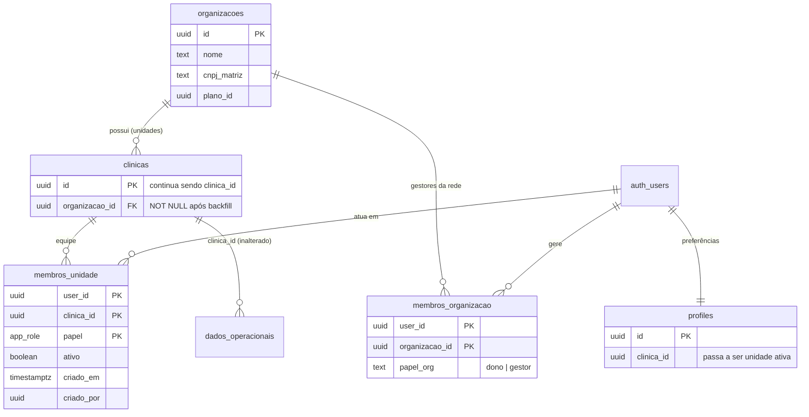
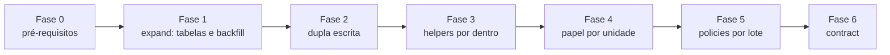

# ADR 0001: Multiunidade com organização, unidades e papel por unidade

- Status: proposta (rodada 1, 27/10/2026). Aguarda aprovação do responsável.
- Autor: `software-architect`
- Itens relacionados: CLIN-QA-008 e CLIN-QA-024 do diagnóstico consolidado; CLIN-QA-202, 203 e 205 de `docs/estrategia/funcoes/02-engenharia.md`.
- Implementação: `tech-lead` e DB Eng. Esta ADR não cria nem aplica migration.

## 1. Contexto

### 1.1 Estado atual (observado no repositório)

| Fato | Evidência |
|---|---|
| Tenant de um nível: a linha pertence a uma `clinica_id` | 366 chamadas `is_same_clinica(`, 303 `get_my_clinica_id()` e 54 `current_clinica_id()` em `supabase/migrations/*.sql` (contagem por `grep -o`, inclui redefinições e comentários) |
| A clínica do usuário é um escalar em `profiles.clinica_id` | `20260321012844_66decb2c-….sql:76-84` (`get_my_clinica_id`), `20260522171216_def6af16-….sql:59-67` (`current_clinica_id`) |
| `is_same_clinica` nega NULL e compara com `profiles.clinica_id`; `anon` revogado | `20260923100000_is_same_clinica_nunca_aceita_null.sql:16-32` |
| Papel global: `user_roles` sem `clinica_id`, `UNIQUE(user_id, role)` | `20260131002504_e20769f5-….sql:42-49` |
| `has_role(_user_id, _role)` ignora a clínica; 71 chamadas nas migrations | `20260131002504_e20769f5-….sql:58-69`; `grep -o "has_role(" … \| wc -l` = 71 |
| Enum de papéis: `admin, medico, recepcao, enfermagem, financeiro` | `20260131002504_e20769f5-….sql:6` |
| Troca de `profiles.clinica_id` protegida por trigger, com exceções para service role, platform admin (impersonação), flag de transação `elolab.allow_clinica_change` e primeira atribuição do dono | `20260727230000_security_fixes_c1_c4.sql:30-74` |
| Já houve vazamento entre clínicas por causa do papel global (corrigido) | `20260729120000_user_roles_vazamento_entre_clinicas.sql:1-45` |
| Nenhuma policy usa `(select auth.uid())` | `grep -o "(select auth.uid())" -i` = 0 |
| Não existe `unidade_id`, `organizacoes` nem `membros_unidade` | diagnóstico consolidado, seção C |

### 1.2 Problema

1. Uma rede com várias unidades não consegue ter um usuário com acesso a mais de uma unidade, nem papéis diferentes em cada uma (por exemplo, médico na unidade A e administrador na B).
2. O papel é global. Um `admin` de uma clínica é `admin` em qualquer verificação `has_role` que esqueça de cruzar com a clínica. Isso já produziu um vazamento.
3. As helpers são `SECURITY DEFINER` chamadas sem `(select …)`. Elas não são inlined e podem ser avaliadas por linha (hipótese de desempenho, `NÃO VERIFICADO` com `EXPLAIN`).

### 1.3 Restrições

- Sem reescrita e sem big bang: mais de 700 referências às helpers atuais em policies e funções.
- O frontend tem 401 de 581 `queryKey` sem tenant (02-engenharia §3). Se uma policy passar a devolver linhas de várias unidades ao mesmo tempo, telas existentes podem misturar dados.
- Impersonação da plataforma e o fluxo de convite dependem de `profiles.clinica_id` hoje.
- Pacientes compartilhados entre unidades envolvem LGPD (controlador, finalidade, compartilhamento): requer avaliação especializada.

## 2. Opções consideradas

| Opção | Descrição | Prós | Contras |
|---|---|---|---|
| A. Manter um nível e criar uma conta por unidade | Cada unidade vira uma clínica independente; o usuário tem um login por unidade | Zero mudança no banco | Não atende rede (relatório consolidado, catálogo comum, gestor único); duplica usuários; não corrige o papel global |
| B. Nova coluna `unidade_id` em todas as tabelas | Hierarquia clínica → unidade em cada linha | Modelo explícito | Toca centenas de tabelas e policies; big bang; `clinica_id` muda de sentido em metade do código |
| **C. `clinica_id` passa a significar "unidade"; acima dela entra `organizacoes`; autorização por `membros_unidade`** | Expand/contract; helpers reescritas por dentro com a mesma assinatura | Nenhuma coluna de dado operacional muda; policies existentes continuam válidas; corrige o papel global | Exige backfill cuidadoso, dupla escrita temporária e testes de RLS que hoje não rodam no CI |
| D. Schema por tenant | Um schema Postgres por clínica | Isolamento forte | Inviável com 454 migrations, realtime e PostgREST; operação cara |

## 3. Decisão

Adotar a **opção C**.

### 3.1 Modelo

Regras:

1. **`clinica_id` continua sendo a chave de tenant de todo dado operacional e clínico.** Semântica nova: "unidade". Nenhuma tabela operacional ganha coluna nova nesta ADR.
2. **Autorização vem de `membros_unidade`**, nunca de `profiles.clinica_id` sozinho. `profiles.clinica_id` passa a ser a **unidade ativa**, uma preferência de navegação que só pode apontar para uma unidade em que o usuário é membro ativo (exceção: impersonação da plataforma, item 3.3).
3. **Policies operacionais continuam restritas à unidade ativa.** `is_same_clinica(x)` passa a exigir `x = unidade ativa` **e** vínculo ativo em `membros_unidade`. Não abrimos "todas as minhas unidades" nas policies existentes, para que nenhuma tela com `queryKey` sem tenant misture dados de unidades diferentes.
4. **Visão de rede** (relatórios consolidados, catálogo e tabela de preço comuns) usa RPCs ou views próprias, que filtram por `minhas_unidades()` ou por `membros_organizacao`. Isso é escopo explícito, nunca efeito colateral.
5. **Dados compartilhados da rede** (catálogo de exames, tabela de preços, convênios) recebem `organizacao_id` em ADR própria, por domínio. Pacientes compartilhados ficam fora desta ADR (requer avaliação especializada de LGPD e decisão de produto).
6. **Papel por unidade:** `tem_papel(p_clinica uuid, p_papel app_role)`. `has_role(uid, role)` passa a significar "tem o papel **na unidade ativa**".

### 3.2 Helpers

Todas `LANGUAGE sql STABLE SECURITY DEFINER SET search_path = ''`, com nomes qualificados, `REVOKE EXECUTE … FROM PUBLIC, anon` e `GRANT EXECUTE … TO authenticated, service_role`.

| Helper | Assinatura | Comportamento |
|---|---|---|
| `minhas_unidades()` (nova) | `RETURNS SETOF uuid` | `clinica_id` de `membros_unidade` com `user_id = (select auth.uid())` e `ativo` |
| `unidade_ativa()` (nova) | `RETURNS uuid` | `profiles.clinica_id` do usuário **se** for membro ativo dessa unidade ou estiver em impersonação válida; caso contrário NULL |
| `tem_papel(p_clinica, p_papel)` (nova) | `RETURNS boolean` | Existe `membros_unidade(user, p_clinica, p_papel, ativo)` |
| `is_same_clinica(uuid)` (reescrita por dentro) | mesma | `record_clinica_id IS NOT NULL AND record_clinica_id = public.unidade_ativa()` |
| `get_my_clinica_id()` / `current_clinica_id()` (reescritas) | mesmas | `RETURN public.unidade_ativa()` |
| `has_role(uuid, app_role)` (reescrita na fase 4) | mesma | `public.tem_papel(public.unidade_ativa(), _role)` quando `_user_id = auth.uid()`; para outro usuário, papel na unidade ativa de quem consulta |
| `definir_unidade_ativa(p_clinica)` (nova, RPC) | `RETURNS void` | Valida vínculo, liga `elolab.allow_clinica_change` na transação e grava `profiles.clinica_id`. Audita em `audit_log` |

Decisão sobre o claim no JWT: **não usar Custom Access Token Hook na primeira versão.** A unidade ativa fica em `profiles.clinica_id`, como hoje, e a troca de unidade não exige renovar o token. O hook (que pode gravar `app_metadata` no token, conforme a documentação oficial) fica como otimização posterior, depois de medir. Motivo: a configuração do hook no GoTrue self-hosted da VPS está `NÃO VERIFICADA`, e um claim desatualizado após a troca de unidade seria uma nova fonte de erro de tenant.

### 3.3 Impersonação e convite

- **Impersonação da plataforma:** `unidade_ativa()` aceita a unidade gravada em `profiles.clinica_id` quando `is_platform_admin()` e existe sessão de impersonação ativa. A sessão de impersonação deve ter registro próprio com expiração (hoje a troca é feita direto em `profiles`; detalhe a confirmar pelo `tech-lead` no código de `platform_start/stop_impersonation`, `NÃO VERIFICADO` nesta rodada).
- **Convite:** aceitar convite passa a **inserir** em `membros_unidade` (papel definido no convite, por unidade) em vez de trocar `profiles.clinica_id` e acumular papéis globais. Isso fecha a parte do CLIN-QA-008 que trata do convite.

### 3.4 Desempenho

- Em policies novas ou normalizadas: `clinica_id = (select public.unidade_ativa())`, `(select auth.uid())` e `(select public.tem_papel(clinica_id, 'admin'))` quando o argumento for constante na consulta.
- Índices: `membros_unidade (user_id) INCLUDE (clinica_id, papel) WHERE ativo`; índice começando por `clinica_id` em toda tabela com RLS; compostos `(clinica_id, data)` em `agendamentos`, `fila_atendimento`, `lancamentos` e `prontuarios`.
- Aceite: `EXPLAIN (ANALYZE)` com `request.jwt.claims` simulado mostra `InitPlan` e `Index Scan` em `agendamentos` com 1M de linhas sintéticas, abaixo de 50 ms.

## 4. Plano de migração (expand/contract)

Cada fase é um conjunto de migrations locais, revisadas, aplicadas pelo pipeline da ADR 0002. Nenhuma fase começa antes de a anterior estar estável em produção por pelo menos um ciclo de release.

| Fase | Conteúdo | Reversão | Gate de saída |
|---|---|---|---|
| **0. Pré-requisitos** | ADR 0002 em vigor (baseline, drift zerado, pipeline com aprovação). CI com banco efêmero e suíte de isolamento entre clínicas executando (CLIN-QA-002). Revogação de `anon` das helpers (CLIN-QA-001/203) | n/a | Suíte de isolamento roda e passa no CI sem `skip` |
| **1. Expand** | Criar `organizacoes`, `membros_organizacao`, `membros_unidade`, `clinicas.organizacao_id` (nullable). Backfill: uma organização por clínica (1:1, dono = `clinicas.owner_id`); `membros_unidade` = `profiles.clinica_id × user_roles` para perfis com clínica. RLS nas tabelas novas. Nenhuma policy existente muda | `DROP` das tabelas novas; nada depende delas | Contagens conferidas: todo perfil com `clinica_id` e papel tem pelo menos uma linha em `membros_unidade`; zero linha órfã |
| **2. Dupla escrita** | Triggers ou ajustes nas RPCs de convite, criação de clínica, troca de papel e desativação de funcionário passam a gravar em `user_roles` **e** em `membros_unidade`. `clinicas.organizacao_id` vira `NOT NULL` depois de novo backfill | Remover triggers | Job de reconciliação diário: diferença entre as duas fontes = 0 por 7 dias |
| **3. Helpers por dentro** | Criar `minhas_unidades`, `unidade_ativa`, `tem_papel`, `definir_unidade_ativa`. Reescrever `is_same_clinica`, `get_my_clinica_id`, `current_clinica_id` com a mesma assinatura | `CREATE OR REPLACE` com o corpo anterior (guardado na própria migration como comentário e num arquivo `down` revisado) | pgTAP: usuário da unidade A não lê nem grava nada da B em todas as tabelas com RLS; usuário sem vínculo não vê nada; impersonação continua funcionando |
| **4. Papel por unidade** | Reescrever `has_role`/`is_admin` para consultar `tem_papel` na unidade ativa. UI de equipe passa a gerenciar papel por unidade | `CREATE OR REPLACE` com o corpo anterior | pgTAP: admin da unidade A não é admin na B; RBAC por tela (`check:permissoes`) verde |
| **5. Policies por lote** | Normalizar as quatro formas de policy para `clinica_id = (select public.unidade_ativa())`, um domínio por migration (agenda, recepção, prontuário, financeiro, laboratório, demais). Criar índices faltantes. Frontend: fábrica `qk` com unidade no primeiro segmento e limpeza de cache em `definir_unidade_ativa` (CLIN-QA-206) | Migration reversa por lote | `EXPLAIN` do lote com `InitPlan`; testes de isolamento verdes por lote |
| **6. Contract** | `user_roles` vira somente leitura (trigger que bloqueia escrita), depois view de compatibilidade sobre `membros_unidade`. Remoção física só após dois ciclos de release sem leitura (monitorar com `pg_stat_user_tables`) | Reativar escrita | Zero leitura de `user_roles` por 2 ciclos |

Seletor de unidade no frontend e telas de rede são entregas de produto que dependem da fase 3, não fazem parte desta ADR.

## 5. Consequências

Positivas:

- Rede multiunidade possível sem tocar nas colunas de dados operacionais.
- O papel deixa de ser global; fecha a classe de bug que causou o vazamento de 29/07.
- As policies existentes continuam válidas durante toda a migração.

Negativas e custos:

- Período de dupla escrita com duas fontes de verdade, que exige reconciliação.
- `unidade_ativa()` acrescenta uma consulta a `membros_unidade` em cada avaliação; mitigado com índice coberto e `(select …)` (fase 5).
- A troca de unidade depende de o frontend limpar o cache; sem a fábrica `qk`, a tela pode mostrar dado em cache da unidade anterior (o banco continua correto).

## 6. Riscos

| Risco | Gravidade se ocorrer | Mitigação |
|---|---|---|
| Backfill incompleto deixa usuário sem vínculo e ele perde acesso após a fase 3 | P1 (fluxo quebrado) | Gate de contagem da fase 1; fase 3 só depois de 7 dias de reconciliação zerada; script de diagnóstico de perfis sem vínculo |
| Reescrita de `is_same_clinica` com erro abre ou fecha acesso para todos | P0 se abrir | pgTAP de isolamento obrigatório no CI antes da migration; aplicação via pipeline com aprovação; reversão pronta |
| Impersonação deixa de funcionar ou passa a valer sem expiração | P1 / P0 | Caso de teste específico na fase 3; registro de sessão de impersonação com expiração |
| Funções `SECURITY DEFINER` antigas que leem `profiles.clinica_id` direto, sem passar pelas helpers, continuam autorizando só pela unidade ativa sem checar vínculo | P0 potencial | Inventário por `grep` de `profiles` + `clinica_id` em funções antes da fase 3; cada uma migrada para `unidade_ativa()` |
| Policy que usa `has_role` sem cruzar com a clínica muda de sentido na fase 4 | P1 | Lista das 71 chamadas revisada na fase 4; teste RBAC por papel |
| Drift entre repositório e produção faz a migration falhar ou agir sobre objeto diferente | P0/P1 | Fase 0 depende da ADR 0002 |
| Pacientes compartilhados entre unidades | Requer avaliação especializada (LGPD) | Fora do escopo; cada unidade continua com seus pacientes |

## 7. Não verificado

- Configuração do GoTrue self-hosted para hooks e SAML.
- Código atual de `platform_start/stop_impersonation` e do fluxo de convite (`accept-invite`, `invite-employee`).
- Desempenho real das helpers atuais e cobertura de índices por tabela.
- Grants reais na VPS (`has_function_privilege`).

## 8. Próximo dono

`tech-lead`: quebrar as fases 0 e 1 em tarefas e migrations locais; DB Eng: pgTAP de isolamento e inventário de funções que leem `profiles.clinica_id`.
