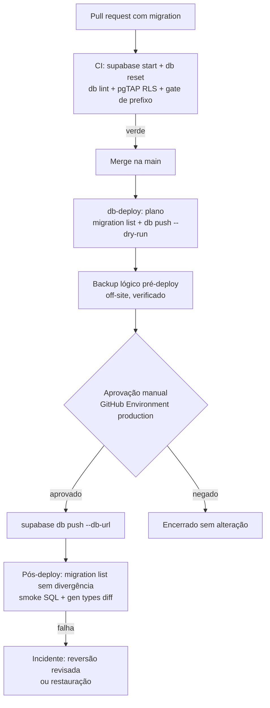

# ADR 0002: Baseline de migrations e deploy de banco por pipeline com aprovação

- Status: proposta (rodada 1, 27/10/2026). Aguarda aprovação do responsável.
- Autor: `software-architect`
- Itens relacionados: CLIN-QA-006 do diagnóstico consolidado; CLIN-QA-201, 204 e 216 de `docs/estrategia/funcoes/02-engenharia.md`; CLIN-QA-005 (backup) como pré-requisito.
- Implementação: `tech-lead`, DevOps/SRE e DB Eng. Esta ADR não aplica migration nem acessa a VPS.

## 1. Contexto

| Fato | Evidência |
|---|---|
| 454 arquivos em `supabase/migrations`, de `20260131002504_…` a `20261027130000_…` | `ls supabase/migrations \| wc -l` = 454 |
| 134 arquivos com nome UUID gerado pelo Lovable, o resto com nome descritivo | `grep -c -E '^[0-9]{14}_[0-9a-f]{8}-[0-9a-f]{4}'` = 134 |
| Versão duplicada `20261010198000` (`checkout_provisionamento_seguro` e `mercadopago_oauth_clinicas`) | `ls … \| cut -c1-14 \| sort \| uniq -d` = `20261010198000` |
| Aplicação manual pelo SQL Editor, "uma por vez e nesta ordem" | `supabase/APLICAR_MIGRATIONS.md:7-9` |
| Deploy de edge functions manual pela linha de comando | `supabase/APLICAR_MIGRATIONS.md:75-83` |
| CI faz `link` com o projeto Cloud `gebygucrpipaufrlyqqj`, e não com a produção self-hosted | `.github/workflows/test.yml:69-70`; `supabase/config.toml:1` |
| O workflow de imagem só valida; o deploy do frontend sai pelo webhook Git do Easypanel | `.github/workflows/deploy.yml` (comentário final) |
| Migrations de 24/10 não aplicadas em produção | diagnóstico consolidado, linha do BA (CLIN-QA-006) |
| `auto-migrate` e `init-db` são stubs 410, mas os slugs já expuseram DDL com service role | 02-engenharia §2; `supabase/functions/auto-migrate/index.ts:2-27` |
| Agendamentos de `pg_cron` criados por 19 migrations | `grep -l "cron.schedule" supabase/migrations/*.sql \| wc -l` = 19 |

Consequência: não há registro confiável do que está aplicado em produção. `supabase_migrations.schema_migrations` da VPS provavelmente diverge do repositório (`NÃO VERIFICADO`). Toda migration nova, inclusive as da ADR 0001, corre o risco de agir sobre um schema diferente do esperado.

## 2. Opções consideradas

| Opção | Prós | Contras |
|---|---|---|
| A. Continuar com o SQL Editor e um checklist melhor | Nenhum custo | Mantém o erro humano, a falta de registro e a ausência de aprovação rastreável |
| B. `supabase migration squash` das 454 migrations | Ferramenta oficial | Gera o schema que **o repositório** produz, não o que **a produção** tem; descarta comandos de dados (documentação oficial do `migration squash`); não resolve drift |
| **C. Baseline a partir da produção reconciliada + `migration repair` + `db push` em pipeline com aprovação** | O baseline descreve o banco real; histórico limpo; aprovação e log no GitHub | Exige uma janela de reconciliação e acesso de leitura à produção |
| D. Ferramenta externa (Atlas, Flyway, Sqitch) | Recursos maduros de drift e plano | Mais uma ferramenta; perde integração com `supabase start`, `gen types` e `db lint` |

## 3. Decisão

Adotar a **opção C**, mantendo o CLI do Supabase como ferramenta única.

### 3.1 Regras permanentes

1. Toda mudança de banco é um arquivo em `supabase/migrations/` com prefixo único `YYYYMMDDHHMMSS` em UTC. Um gate no CI falha se houver prefixo repetido ou se uma migration já presente na `main` for editada.
2. Proibido aplicar DDL pelo SQL Editor ou por edge function. Exceção só em incidente, com registro posterior via `migration repair` e ADR de incidente.
3. A migration é testada em banco efêmero (`supabase start` + `supabase db reset`) no CI, com `db lint` e pgTAP de RLS, antes do merge.
4. Produção só recebe migration pelo job `db-deploy`, a partir da `main`, com aprovação manual registrada.
5. Migration destrutiva (`DROP`, `ALTER … TYPE`, `DELETE`/`UPDATE` em massa) exige rótulo no PR, plano de reversão escrito e backup imediatamente anterior verificado.
6. Edge functions seguem o mesmo pipeline. Um job de conferência compara as funções publicadas com as pastas do repositório e falha se houver slug extra (por exemplo `auto-migrate`, `init-db`).

### 3.2 Pipeline

Detalhes:

- **Aprovação:** GitHub Environment `production` com revisores obrigatórios (o responsável e mais uma pessoa) e `prevent self-review`. O plano (`db push --dry-run` e a lista de versões pendentes) aparece no resumo do job antes da aprovação.
- **Credencial:** connection string guardada como secret do Environment, com um papel Postgres de migração dedicado, sem uso da senha de `postgres` no dia a dia. Nunca impressa no log.
- **Acesso de rede:** o Postgres da VPS não deve ser exposto à internet. Preferência: túnel SSH a partir do job com chave restrita (`permitopen` para a porta do Postgres, sem shell). Alternativa: runner self-hosted isolado na VPS. A escolha fica com DevOps; a topologia de rede do Easypanel está `NÃO VERIFICADA`.
- **Concorrência:** `concurrency: db-deploy-production` sem cancelamento, para que dois deploys nunca rodem juntos.
- **Comandos** (flags conferidas na referência oficial do CLI): `supabase migration list --db-url`, `supabase db push --db-url … --dry-run`, `supabase db push --db-url …`, `supabase migration repair <versão> --status applied|reverted --db-url …`.

### 3.3 Baseline

O baseline é feito **uma vez**, numa janela combinada, sem alterar o schema de produção.

1. **Congelamento:** nenhuma migration nova vai para produção durante a janela.
2. **Retrato da produção (somente leitura):** `supabase db dump --db-url … -f prod_schema.sql` e consulta de `supabase_migrations.schema_migrations`. Também exportar o que o dump padrão não cobre: `cron.job`, policies e buckets de `storage`, publicação `supabase_realtime`, grants de funções (`has_function_privilege` de `anon`), extensões e versões. O `db dump` exclui schemas gerenciados como `auth` e `storage` (documentação oficial).
3. **Retrato do repositório:** banco efêmero com `supabase db reset` a partir das 454 migrations, dump com os mesmos parâmetros.
4. **Relatório de drift:** diff dos dois retratos. Cada diferença recebe uma decisão: (a) a produção está certa, e o repositório ganha uma migration corretiva; (b) o repositório está certo, e a produção recebe a migration pendente pelo processo atual, uma última vez, com registro; (c) objeto órfão, que é removido depois por migration própria. O drift é o primeiro entregável e vai para o backlog.
5. **Resolver a versão duplicada:** renomear localmente um dos arquivos `20261010198000_*` para uma versão livre, conferindo antes qual deles a produção registrou.
6. **Gerar o baseline:** `supabase/migrations/<versão>_baseline.sql` a partir do dump reconciliado, com uma migration de dados de referência separada (planos, templates e outros dados que o dump de schema não leva) e um arquivo declarativo dos jobs de `pg_cron`.
7. **Arquivar o histórico:** mover os 454 arquivos para `supabase/migrations_legacy/`, fora do caminho do CLI. Eles continuam no Git para auditoria.
8. **Validação:** `supabase db reset` com o baseline produz um schema idêntico ao dump da produção (diff vazio).
9. **Registro na produção, sem executar SQL de schema:** depois de backup verificado, `supabase migration repair --status reverted` para as versões antigas registradas e `supabase migration repair <versão_baseline> --status applied`. `supabase migration list --db-url` passa a mostrar só o baseline.
10. **Retomar:** a próxima migration já segue o pipeline da seção 3.2.

### 3.4 CI

- Trocar o passo `supabase link --project-ref gebygucrpipaufrlyqqj` (`test.yml:69-70`) por `supabase start` e `supabase db reset` no runner, seguido de `supabase db lint --local`, pgTAP de RLS e a suíte de isolamento entre clínicas com seed sintético de duas clínicas (CLIN-QA-002).
- `supabase gen types` contra o banco efêmero, com falha se `src/integrations/supabase/types.ts` divergir (CLIN-QA-209).
- `supabase/config.toml` deixa de apontar para o projeto Cloud como se fosse o ambiente real; o `project_id` passa a ser só identificador local.

## 4. Plano de migração

| Etapa | Dono | Saída | Depende de |
|---|---|---|---|
| 1. Gate de prefixo único e de migration imutável no CI | `tech-lead` | Script e passo no `test.yml` | — |
| 2. CI com banco efêmero, pgTAP e suíte de isolamento | `tech-lead` + QA | Job verde sem `skip` | 1 |
| 3. Backup off-site verificado e uma restauração cronometrada | DevOps/SRE | Evidência de restauração | CLIN-QA-005 |
| 4. Retrato da produção e relatório de drift (só leitura) | DB Eng, com autorização do responsável para acessar a VPS | `docs/…/drift-<data>.md` | 3 |
| 5. Reconciliação do drift | DB Eng + `tech-lead` | Migrations corretivas | 4 |
| 6. Baseline, arquivamento e `migration repair` | DB Eng, com aprovação | `migration list` sem divergência | 5 |
| 7. Job `db-deploy` com Environment e revisores | DevOps/SRE | Primeiro deploy real pelo pipeline | 6 |
| 8. Deploy de edge functions pelo pipeline e conferência de slugs | DevOps/SRE | `auto-migrate` e `init-db` removidos do servidor | 7 |
| 9. Aposentar `supabase/APLICAR_MIGRATIONS.md` | `tech-lead` | Documento substituído por runbook do pipeline | 7 |

Enquanto a etapa 7 não estiver pronta, o processo manual continua, mas cada aplicação deve ser registrada com `migration repair` para não ampliar o drift.

## 5. Consequências

Positivas: histórico limpo e rastreável; aprovação registrada; CI testa RLS contra um banco de verdade; ADR 0001 passa a ter base segura.

Negativas: uma janela de congelamento; o histórico das 454 migrations deixa de ser executável pelo CLI (continua legível no Git); exige secret com acesso ao banco de produção fora da VPS.

## 6. Riscos

| Risco | Gravidade se ocorrer | Mitigação |
|---|---|---|
| `migration repair` mal executado faz o `db push` reaplicar migrations antigas | P0 (dado corrompido) | Backup verificado antes; `db push --dry-run` precisa listar zero pendências após o repair; dois revisores |
| Baseline sem objetos fora de `public` (cron, storage, realtime, grants) | P1 | Checklist do item 3.3.2; diff de validação do item 3.3.8 inclui esses objetos |
| Secret de banco vazado pelo CI | P0 | Environment protegido, papel de migração dedicado, sem `echo`, rotação após o baseline |
| Postgres exposto à internet para o pipeline | P0 | Túnel SSH restrito ou runner isolado; nunca abrir a porta publicamente |
| Migration bloqueia tabela quente em horário de atendimento (`ALTER TABLE` com lock) | P1 | Revisão de lock no PR; `CREATE INDEX CONCURRENTLY` em migration própria; janela fora do horário |
| Webhook do Easypanel publica frontend antes do banco | P1 | Branch protection (já recomendado em `deploy.yml`); ordem: banco, depois edge functions, depois frontend; mudanças de schema sempre compatíveis com a versão anterior do frontend (expand/contract) |
| Equipe volta a usar o SQL Editor | P1 | Regra 3.1.2; conferência periódica de `migration list` com alerta de divergência |

## 7. Não verificado

- Conteúdo real de `supabase_migrations.schema_migrations` na VPS e a extensão do drift.
- Topologia de rede do Postgres no Easypanel e viabilidade do túnel SSH.
- Se o projeto Cloud `gebygucrpipaufrlyqqj` ainda existe e se tem dados.
- Política de backup do Easypanel.

## 8. Próximo dono

`tech-lead`: etapas 1, 2 e 9. DevOps/SRE: etapas 3, 7 e 8. DB Eng: etapas 4 a 6, que dependem de autorização explícita do responsável para leitura na VPS.
