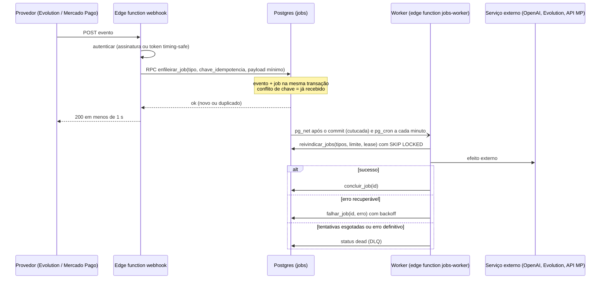

# ADR 0003: Fila de jobs para webhooks com SKIP LOCKED e DLQ

- Status: proposta (rodada 1, 27/10/2026). Aguarda aprovação do responsável.
- Autor: `software-architect`
- Itens relacionados: CLIN-QA-009 e CLIN-QA-027 do diagnóstico consolidado; CLIN-QA-207 e 213 de `docs/estrategia/funcoes/02-engenharia.md`.
- Implementação: `tech-lead` e Backend. Esta ADR não cria nem aplica migration.

## 1. Contexto

### 1.1 Webhooks hoje

| Fato | Evidência |
|---|---|
| WhatsApp (Evolution): deduplicação por `message_id` com tratamento de `23505` | `supabase/functions/whatsapp-webhook/index.ts:159-219` |
| WhatsApp: chamada **síncrona** à OpenAI dentro do request do webhook | `whatsapp-webhook/index.ts:410` e `:539` |
| WhatsApp: envio da resposta ao Evolution também no mesmo request | `whatsapp-webhook/index.ts:1215` |
| WhatsApp: token comparado com `!==` (não é timing-safe) | `whatsapp-webhook/index.ts:45` (o relatório 02-engenharia §5 cita a linha 38, deslocada pelas alterações locais) |
| Mercado Pago: assinatura `x-signature` validada antes de tudo | `supabase/functions/mercadopago-webhook/index.ts:61-85` |
| Mercado Pago: idempotência por `event_id` em `mercadopago_webhook_logs`, com `23505` | `mercadopago-webhook/index.ts:91-128` |
| Mercado Pago: processamento síncrono; `processado = true` só no fim | `mercadopago-webhook/index.ts:158, 179, 311` |
| Reprocessamento manual do Mercado Pago reenvia o payload ao próprio webhook com segredo interno | `supabase/functions/platform-reprocess-job/index.ts:25-29` |

[H] Sob latência da OpenAI, o request do WhatsApp pode exceder o tempo do provedor ou o wall-clock do edge-runtime. O Evolution reenvia, e a deduplicação por `message_id` evita gravar a mensagem duas vezes, mas não garante que a resposta da IA seja enviada exatamente uma vez. Os limites do edge-runtime na VPS estão `NÃO VERIFICADOS`.

### 1.2 Padrão que já funciona: `notification_queue`

- Tabela com `status`, `tentativas`, `max_tentativas`, `agendado_para` (`20260131022551_743b4c30-….sql:20-39`).
- Reserva atômica com `FOR UPDATE SKIP LOCKED`, limite por lote e reserva só para `service_role` (`20261011440000_fila_notificacoes_resultado_incerto.sql:8-40`).
- Item preso em `enviando` por mais de 10 minutos vai para `incerto`, e não é reenviado sem conferência no provedor (mesmo arquivo, linhas 15-22).
- Backoff exponencial com teto de 60 minutos e estado terminal `erro` (`supabase/functions/process-notification-queue/index.ts:39-47`).
- `pg_cron` e `pg_net` habilitados (`20260303205606_c04525cf-….sql:3-4`); 19 migrations agendam jobs por `cron.schedule`.

A decisão generaliza esse desenho em vez de inventar outro.

## 2. Opções consideradas

| Opção | Prós | Contras |
|---|---|---|
| A. Manter síncrono e aumentar timeouts | Nenhum código novo | Não resolve reenvio do provedor nem duplicidade; acopla a disponibilidade do webhook à da OpenAI |
| B. `EdgeRuntime.waitUntil` no próprio webhook | Pouco código | Sem durabilidade: se o container reiniciar, o trabalho se perde; sem retentativa nem DLQ; suporte no edge-runtime self-hosted `NÃO VERIFICADO` |
| C. `pgmq` (extensão de fila) | Semântica pronta de visibilidade e arquivo | Disponibilidade da extensão no Postgres da VPS `NÃO VERIFICADA`; mais uma peça para backup e baseline (ADR 0002) |
| **D. Tabela `jobs` própria com `FOR UPDATE SKIP LOCKED`, lease e estado `dead` como DLQ** | Mesmo padrão já validado em `notification_queue`; transacional com os dados do negócio; sem dependência nova | Código de fila próprio para manter; throughput limitado pelo Postgres (suficiente para centenas de clínicas, hipótese) |
| E. Broker externo (Redis/BullMQ, SQS) | Throughput alto | Outro serviço na VPS, perde a transação com o banco; desproporcional à escala atual |

## 3. Decisão

Adotar a **opção D**. Webhooks **só validam, persistem e respondem**. Todo efeito (consulta à IA, envio de mensagem, baixa de pagamento, ativação de plano) acontece num worker que consome `jobs`.

### 3.1 Fluxo



Se a persistência falhar, o webhook responde 5xx para que o provedor reenvie. Ele nunca responde 200 sem ter gravado o evento.

### 3.2 Modelo

```
jobs
  id                 uuid PK
  tipo               text NOT NULL          -- 'whatsapp.mensagem_recebida', 'mercadopago.evento', ...
  clinica_id         uuid NULL              -- NULL só para jobs da plataforma
  chave_idempotencia text NOT NULL          -- message_id, event_id, ...
  chave_ordenacao    text NULL              -- ex.: conversa; garante ordem por chave
  payload            jsonb NOT NULL         -- mínimo: ids e referência ao log, não o corpo inteiro
  status             text NOT NULL          -- pendente | executando | concluido | incerto | dead | cancelado
  tentativas         int  NOT NULL DEFAULT 0
  max_tentativas     int  NOT NULL DEFAULT 5
  executar_apos      timestamptz NOT NULL DEFAULT now()
  bloqueado_ate      timestamptz NULL       -- lease
  ultimo_erro        text NULL
  criado_em, atualizado_em, concluido_em timestamptz
  UNIQUE (tipo, chave_idempotencia)
  INDEX (status, executar_apos) WHERE status = 'pendente'
  INDEX (clinica_id, status)
```

Regras:

1. **Entrega pelo menos uma vez.** Todo handler é idempotente. A chave `UNIQUE (tipo, chave_idempotencia)` evita o job duplicado; o handler confere o estado do domínio antes de agir (por exemplo, pagamento já baixado).
2. **Reserva:** `reivindicar_jobs(p_tipos text[], p_limite int, p_lease interval)`, `SECURITY DEFINER`, `SET search_path = ''`, executável só por `service_role`. Seleciona `pendente` com `executar_apos <= now()` por `FOR UPDATE SKIP LOCKED`, muda para `executando`, incrementa `tentativas` e grava `bloqueado_ate = now() + p_lease`.
3. **Lease expirado:** job em `executando` com `bloqueado_ate < now()` volta para `pendente` se o tipo for seguro para repetir. Se o tipo tiver efeito externo não idempotente (envio de mensagem), vai para `incerto`, como já faz `notification_queue`. Cada tipo declara isso no registro de handlers.
4. **Backoff:** exponencial com jitter, teto de 60 minutos, alinhado a `process-notification-queue/index.ts:40`.
5. **DLQ:** `dead` é terminal. Entra quando `tentativas >= max_tentativas` ou o erro é definitivo (payload inválido, clínica inexistente). `incerto` também exige ação humana. Ambos aparecem no painel da plataforma, com "reenfileirar" e "cancelar", auditados em `audit_log`. O reprocessamento do Mercado Pago em `platform-reprocess-job` passa a reenfileirar o job em vez de chamar o webhook com segredo interno.
6. **Ordem por chave:** quando `chave_ordenacao` existe, a reserva só pega o job mais antigo pendente daquela chave e nenhum se houver outro da mesma chave em `executando`. Mensagens da mesma conversa são respondidas em ordem.
7. **Justiça entre clínicas:** a reserva limita quantos jobs de uma mesma `clinica_id` entram em cada lote (por exemplo, `row_number() over (partition by clinica_id) <= 10`), para que uma clínica com rajada não atrase as outras.
8. **Tenant e acesso:** RLS ligada, sem policy para `anon` e `authenticated`. Leitura do painel por RPC restrita a platform admin. O handler sempre usa o `clinica_id` do job e o confere contra o registro de domínio antes de agir.
9. **Dados pessoais:** o payload guarda o mínimo (ids, referência ao log do webhook). Conteúdo de mensagem de paciente fica onde já está (mensagens do WhatsApp). Retenção: `concluido` removido após 30 dias; `dead` após análise. Prazos finais requerem avaliação especializada (LGPD).
10. **Disparo do worker:** trigger `AFTER INSERT` em `jobs` chama `net.http_post` (`pg_net`) para o `jobs-worker`. A requisição só sai depois do commit. `pg_cron` a cada minuto cobre perdas da cutucada. O segredo do cron segue o padrão já usado (`20260727235000_cron_segredo_proprio.sql:56-60`).
11. **Trabalho pesado:** IA, XML TISS, PDF e backup podem estourar os limites do edge-runtime (`NÃO VERIFICADO`). O contrato de `jobs` permite trocar o consumidor por um worker Node ou Deno dedicado na VPS sem mudar os produtores.
12. **`notification_queue` continua como está.** Ela funciona e já tem `incerto`. A unificação com `jobs` será avaliada em ADR própria depois de dois tipos de job estáveis em produção.

### 3.3 Contratos dos primeiros tipos

| Tipo | Chave de idempotência | Chave de ordenação | Efeito externo idempotente? | `max_tentativas` |
|---|---|---|---|---|
| `mercadopago.evento` | `event_id` (já único em `mercadopago_webhook_logs`) | `payment_id` ou `preapproval_id` | Sim: consulta à API do MP e baixa condicionada ao estado | 8 |
| `whatsapp.mensagem_recebida` | `message_id` do Evolution | id da conversa | Não: envio de mensagem. Lease expirado vai para `incerto` | 3 |

Testes obrigatórios por tipo, em sandbox ou com provedor simulado e dados sintéticos: (a) o mesmo evento entregue duas vezes gera um único efeito; (b) a falha do serviço externo leva a retentativa com backoff e depois a `dead`; (c) o worker morto no meio do job não duplica o envio da mensagem; (d) o webhook responde em menos de 1 s com a OpenAI simulada a 30 s. A integração só é considerada pronta com esses testes executados, não pela existência da configuração.

## 4. Plano de migração (expand/contract)

| Fase | Conteúdo | Reversão | Gate de saída |
|---|---|---|---|
| **0. Pré-requisitos** | ADR 0002 em vigor (pipeline de banco). Comparação timing-safe do token do WhatsApp (CLIN-QA-217) | n/a | — |
| **1. Expand** | Migration com `jobs`, `enfileirar_job`, `reivindicar_jobs`, `concluir_job`, `falhar_job`, trigger `pg_net` e agendamento `pg_cron`. Edge function `jobs-worker` com registro de handlers vazio. Testes pgTAP da reserva (duas sessões não pegam o mesmo job; lease expirado; ordem por chave) | `DROP` das peças novas; ninguém produz jobs ainda | pgTAP verde no CI efêmero |
| **2. Mercado Pago** | Extrair o processamento atual para `_shared/mercadopago/processar.ts`. O webhook grava o log, enfileira e responde. Handler `mercadopago.evento` chama o mesmo código. Flag de ambiente `MP_WEBHOOK_MODO=sincrono|fila`, começando em `sincrono` | Voltar a flag para `sincrono` | 7 dias em `fila` sem `dead` inesperado; todos os logs com `processado = true` |
| **3. WhatsApp** | Mesmo padrão: o webhook grava a mensagem (deduplicação atual) e enfileira. IA e envio vão para o handler. Ativação por clínica (lista de clínicas piloto) antes de ligar para todas | Remover a clínica da lista | p95 do webhook < 1 s; zero resposta duplicada em 14 dias nas clínicas piloto (amostragem por `message_id`) |
| **4. Painel DLQ** | Tela na plataforma com `dead` e `incerto`, reenfileirar e cancelar, com auditoria. `platform-reprocess-job` passa a usar `jobs` | Tela é somente leitura até a validação | Teste de aceite: job que falha N vezes aparece no painel e pode ser reenfileirado |
| **5. Contract** | Remover o caminho síncrono e as flags depois de dois ciclos de release. Remover o caminho "webhook chamado com segredo interno" | — | Nenhum uso do modo síncrono por 2 ciclos |

## 5. Consequências

Positivas: webhooks rápidos e estáveis; falha da OpenAI ou do Evolution não derruba o recebimento; retentativa e DLQ visíveis; base para TISS, NFS-e e PDF assíncronos.

Negativas: a resposta ao paciente no WhatsApp ganha a latência da cutucada (segundos) e, no pior caso, a do cron (até 1 minuto); mais uma tabela quente para monitorar e limpar; os handlers precisam ser escritos para repetição.

## 6. Riscos

| Risco | Gravidade se ocorrer | Mitigação |
|---|---|---|
| Handler não idempotente duplica baixa de pagamento ou ativação de plano | P1 (cobrança errada) | Baixa condicionada ao estado atual na mesma transação; teste (a) obrigatório; não alterar `pagamentos_mercadopago` e `lancamentos` fora do fluxo atual |
| Mensagem duplicada ou fora de ordem para o paciente | P1 | `chave_ordenacao`; estado `incerto` no lease expirado; piloto por clínica |
| `pg_net` ou `pg_cron` parados na VPS: jobs acumulam sem alerta | P1 | Alerta por idade do job pendente mais antigo e por contagem de `dead`; monitoramento de `cron.job_run_details` |
| Job processado com `clinica_id` errado | P0 | Handler confere o `clinica_id` do job com o registro do domínio; testes com duas clínicas sintéticas |
| Payload guarda dado pessoal além do necessário | Requer avaliação especializada (LGPD) | Payload mínimo; retenção definida; sem conteúdo clínico no job |
| Tabela `jobs` cresce e degrada a reserva | P2 | Índice parcial em `pendente`; limpeza diária de `concluido`; `autovacuum` ajustado |
| Edge-runtime mata o worker no meio do lote | P2 | Lote pequeno, lease curto, `incerto` para efeitos não idempotentes; worker dedicado quando houver trabalho pesado |

## 7. Não verificado

- Limites de memória e wall-clock do edge-runtime no Easypanel.
- Política de reenvio e timeout do Evolution configurado na VPS.
- Disponibilidade de `pgmq` no Postgres da VPS (só relevante se a opção C for reconsiderada).
- Funcionamento atual de `pg_net` e `pg_cron` em produção.

## 8. Próximo dono

`tech-lead`: fases 1 e 2. Backend: handlers e testes de sandbox das fases 2 e 3. DevOps/SRE: alertas de fila e de cron.
